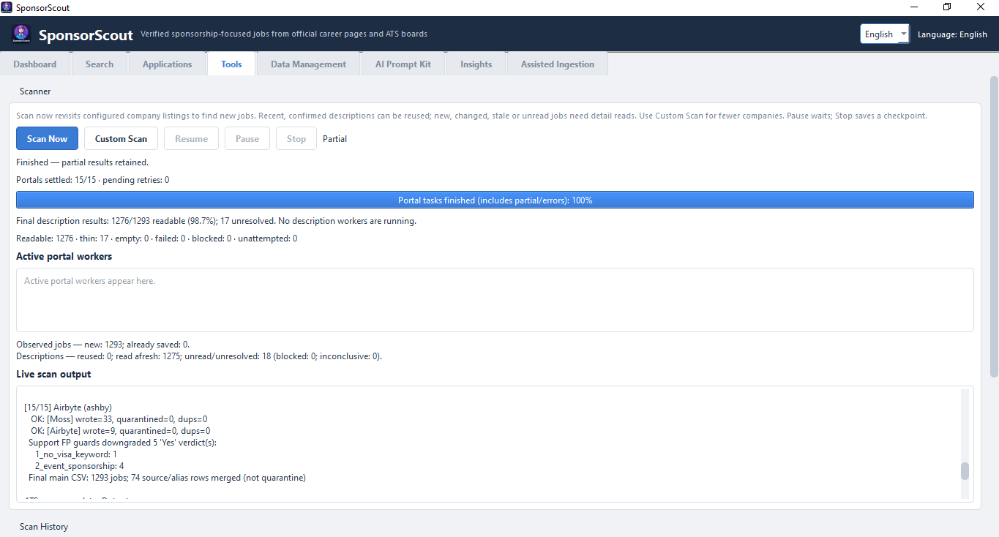

# SponsorScout

[🇬🇧 English](#-english) · [🇮🇹 Italiano](#-italiano)

Discover jobs from configured official sources and check the available
sponsorship evidence. Results and application notes are stored on your computer.

> **Start here:** [📸 Screenshots / Schermate](#-screenshots) ·
> [🚀 Quick Start / Avvio Rapido](#-quick-start) ·
> [🗂 The Eight Tabs / Le Otto Schede](#-the-eight-tabs)


*The screenshots below are illustrative captures from the current eight-tab UI;
they use an isolated local demonstration database and no cloud account.
They are real Qt captures, not mockups: four fictional postings and one fictional
application. Tools and Assisted are idle, and Advanced starts collapsed.
English and Italian sections have matching-language captures. Window decoration,
font sizes, clipping, enabled buttons and counts depend on your OS and run state.
Scroll inside Tools and Insights to reach lower controls/charts. A separate
finished-run screenshot below is from the supplied Windows run, not demo data.*

---


# 🇬🇧 English

## 📖 Contents

- **[📸 Screenshots](#-screenshots)** — see every tab before you install
- **[🚀 Quick Start](#-quick-start)** — install, scan, search in three steps
- **[🗂 The Eight Tabs](#-the-eight-tabs)** — the full workspace tour
- [Download](#-download)
- [What It Does](#-what-it-does)
- [Current source stage](#current-source-stage)
- [Open issues and verification](issues.md)
- [Scanning](#-scanning)
- [Verification and Fix Register](#verification-and-fix-register)
- [Where Your Data Lives](#-where-your-data-lives)
- [Troubleshooting](#-troubleshooting)
- [Building From Source](#-building-from-source)
- [Requirements](#-requirements)
- [License](#-license)

---

## 📥 Download

This delivery contains source, **not an installer**. Run it with Python/venv
using [Building From Source](#-building-from-source). The build scripts support
the formats below. Check the [GitHub Releases page](https://github.com/Kazehaya395/SponsorScout/releases)
for any separately published assets; this review does not verify their availability
or that an older installer contains these source changes:

| Platform | File |
|----------|------|
| Windows 10 / 11 | `sponsorscout-<version>-setup.exe` |
| Linux (Debian / Ubuntu / Mint) | `sponsorscout_<version>_<arch>.deb` |
| Linux (Fedora / RHEL / openSUSE) | `sponsorscout-<version>-1.<arch>.rpm` |

`<arch>` is your machine's architecture (`amd64` on most desktops, `arm64` on
Raspberry Pi / Graviton). Pick the file for your platform. The app and its
browser are bundled, so no Python is needed.

Installing the Linux packages:

```bash
# Debian / Ubuntu / Mint
sudo apt install ./sponsorscout_<version>_<arch>.deb

# Fedora / RHEL / openSUSE
sudo dnf install ./sponsorscout-<version>-1.<arch>.rpm   # or: sudo zypper install ...
```

Both packages install to `/opt/sponsorscout` and add a launcher plus a desktop
entry; the bundled Chromium is used automatically.

---

## 📸 Screenshots

> **See the whole workspace at a glance.** These are current captures of all
> eight tabs. Click any image to open the full-size version.

<table>
  <tr>
    <td align="center"><strong>1 · Dashboard</strong><br><a href="assets/main_dashboard.png"></a></td>
    <td align="center"><strong>2 · Search</strong><br><a href="assets/job_search_table.png"></a></td>
  </tr>
  <tr>
    <td align="center"><strong>3 · Applications</strong><br><a href="assets/applications_dashboard.png"></a></td>
    <td align="center"><strong>4 · Tools</strong><br><a href="assets/scanning_tool.png"></a></td>
  </tr>
  <tr>
    <td align="center"><strong>5 · Data Management</strong><br><a href="assets/backend_data_management.png"></a></td>
    <td align="center"><strong>6 · AI Prompt Kit</strong><br><a href="assets/AI_tailoring_setup.png"></a></td>
  </tr>
  <tr>
    <td align="center"><strong>7 · Insights</strong><br><a href="assets/insights_dashboard.png"></a></td>
    <td align="center"><strong>8 · Assisted Ingestion</strong><br><a href="assets/assisted_ingestion.png"></a></td>
  </tr>
</table>

**Bonus — Custom Scan:** choose source types and companies before a targeted run.

<a href="assets/custom_portal_selection.png"></a>

---

## ✨ What It Does

- **Scans seeded job sources** — 10 ATS provider types (Ashby, Greenhouse,
  Lever, SmartRecruiters, Personio, Recruitee, Workable, Workday, Teamtailor,
  BambooHR) through their public job feeds/APIs, plus employer and recruiter
  career boards with a headless browser when needed. A centralised board may
  link to an external employer/aggregator detail page. Providers, access and
  extracted attributes can be incomplete; consult the recorded outcomes.
- **Analyses available job text** — sponsorship, relocation support, remote type and
  EU Blue Card eligibility, detected from the job description.
- **Extracts the experience requirement** — the exact figure the ad states
  (`4+`, `3-5 years`, `6 months`), or the seniority level (`Senior`), read in
  English, German, Italian, Dutch, French, Spanish and Portuguese.
- **Stores app records locally** — SQLite plus local documents/logs. Scanning
  fetches job sites; clipboard text is shared externally only if you paste it.
- **Tracks applications** — Saved → Applied → Interview → Offer → Rejected.
- **Two languages** — English and Italian, switchable at any time.

---

## 🚀 Quick Start

> **New here?** Follow these steps. Later scans can also be slow if descriptions need rereading or access fails.

1. **Set up this source delivery** — follow the Python/venv commands under
   [Building From Source](#-building-from-source), then launch the app.
   Separately published installers, if available, are optional and may be older.
2. **Run the first scan** — accept the first-run prompt, or press **Scan Now**
   in **Tools**. A full scan can take minutes to hours depending on how many
   companies are enabled. You can pause, stop and resume without losing the jobs
   already found.
3. **Find and track jobs** — open **Search** to filter by country, title, visa
   sponsorship, EU Blue Card, remote type and regex; save interesting jobs to
   **Applications**.
4. **Go deeper** — open **Insights** for category, skill, domain and
   sponsorship charts, **AI Prompt Kit** to assemble an application prompt, and
   **Assisted Ingestion** for explicit browser collection or access/recovery issues; access is not guaranteed.

Running from source? See [Building From Source](#-building-from-source).

---

## Current source stage

This delivery is the **complete reviewed source code**, not a newly built
installer. Package metadata remains **0.2.0**. For Python/venv users, extract into
a fresh folder and run the source commands below; do not delete your existing
user-data folder. Close the old app and back up that folder first.

- Repeat scans still revisit selected listings. Confirmed, unchanged, active
  descriptions captured within 24 hours can be reused; new, changed, stale or
  unread jobs need detail reads. Reuse does not renew the original capture time.
  A silent edit not exposed in listing metadata may wait for a later stale read
  or your explicit reread; reuse is not proof that every hidden JD edit is detected.
- **Read saved descriptions again (next new run only)** is a confirmed, one-shot
  Advanced option. Resume retains its original targets, phases and refresh policy;
  it does not widen a Career-only campaign into ATS or add companies.
- Tools separates portal-task completion from readable descriptions. A finished
  run shows static **Final description results**, not a still-running JD bar.
  Partial/error/cancelled results retain their real counts; unavailable coverage
  is not invented as zero. A new run restores live progress.
- Maintenance and diagnostic controls are collapsed. Insights separates technical,
  professional/domain and soft skills; employee benefits are not role skills.
- **Manychat verification is an unresolved bug.** No bypass, universal access,
  live pagination completeness or fresh Windows binary validation is claimed.
  Read [issues.md](issues.md) for current limits and historical open reports.

The detailed scanning, recovery, country maintenance, storage, troubleshooting
and packaging sections remain below. Earlier stage-specific test figures are
historical, not the final validation count; see the verification register.

---

## 🗂 The Eight Tabs

Use the language selector at the top right to switch English/Italian. Job text,
company names, raw diagnostics and some technical labels are not translated.
The images show current widgets; they are examples, not promised job totals.

| # | Tab | Main purpose | Screenshot |
|---|-----|--------------|------------|
| 1 | [Dashboard](#1-dashboard) | Saved-data overview and latest-run findings | [View](assets/main_dashboard.png) |
| 2 | [Search](#2-search) | Filter, page through and open saved job rows | [View](assets/job_search_table.png) |
| 3 | [Applications](#3-applications) | Edit local application status and notes | [View](assets/applications_dashboard.png) |
| 4 | [Tools](#4-tools) | Scan, resume, inspect progress and history | [View](assets/scanning_tool.png) |
| 5 | [Data Management](#5-data-management) | Edit your ATS/Career company lists | [View](assets/backend_data_management.png) |
| 6 | [AI Prompt Kit](#6-ai-prompt-kit) | Assemble a clipboard message, not generate AI output | [View](assets/AI_tailoring_setup.png) |
| 7 | [Insights](#7-insights) | Explore the selected saved-job data | [View](assets/insights_dashboard.png) |
| 8 | [Assisted Ingestion](#8-assisted-ingestion) | Explicit app-browser collection and recovery | [View](assets/assisted_ingestion.png) |

### 1. Dashboard

The top buttons are **Rescan Companies** and **Refresh**. The seven cards are
**Total Companies**, **Saved Jobs**, **Sponsored Jobs**, **Remote Jobs**,
**EU Blue Card**, **Applications** and **No Jobs (last run)**. This is a saved-data
overview, not a count of every bundled seed or every vacancy on the Internet.
The remote card can show remote and hybrid separately.

Below are **Top Employers by Sponsor Score**, **Jobs by Country** and
**No Jobs Found (last run)**. Employers are ranked by **Max Sponsor Score**, not
by sponsored-job count. A zero sponsorship/Blue Card card means no saved positive
evidence under that metric; it does not turn Unknown into No. The latest-run
no-jobs table also displays status/provider/error information: a blocked Manychat
row is **not proof that Manychat has no vacancies**. Inspect its error and Tools
history. **Scan Now** and **Custom Scan** are in Tools, not this action row.


### 2. Search

Enter **Job title**, **Company** or **Location**, choose **Country**, **Remote**,
**Experience** or **Run**, then press **Search**. **Clear** resets the filters.
The **Sponsor**, **Blue Card** and **Reloc** checkboxes ask for positive matches;
they are **not three-way Yes/No/Unknown filter menus**. The results themselves
keep Yes/No/Unknown distinct (`?` means Unknown). **Regex** applies to the three
text fields. Select 100/200/500/1000 rows per page and use **◀ / ▶**; the count
line shows the current page range and total matching rows.

Columns show title, company, country, location, experience, support verdicts,
remote type and first-seen date. Unknown country is not guessed from the seed.
A saved listing row does not prove a full JD was read; listing titles can include
site metadata that still needs extraction-quality work (see issues).
Double-click a row to open its original website, or right-click for **Open in
browser**, **Copy URL**, **Save to Applications**. Selecting a job supplies the
selection to AI Prompt Kit; use that tab's **Load JD** to load its text.


### 3. Applications

Save a job from Search's right-click menu first. **Saved applications** shows
**Company**, **Title**, **Status**, **Saved on**, **URL** and **Latest notes**.
Select a row to reveal the **Status** dropdown, **Notes**, **Save** and **Cancel**.
The available states are saved, applied, interview, offer and rejected; you choose
them yourself. Saving notes/status does **not** submit an application to an employer.

**Remove Selected** removes the local tracker entry after confirmation.
**Activity log** records status changes made in this session; it is not a permanent
mailbox or a complete historical audit. Saved on is the original saved date,
not an editable interview/follow-up calendar. Status and latest notes persist
in SQLite. **Current limitation:** selecting a row starts the Notes input empty.
Save replaces the stored latest note with that input, including an empty string.
Copy/re-enter an existing note before a status-only save if you want to keep it;
this review documents that preservation risk rather than silently changing it. The screenshot selects one fictional applied entry to show the editor.


### 4. Tools

The everyday row is **Scan Now**, **Custom Scan**, **Resume**, **Pause**, **Stop**.
Buttons enable/disable according to the current worker and saved checkpoint.
**Pause** suspends work cooperatively; **Stop** asks it to finish safely and retain
saved work. **Resume** continues the original campaign, not a newly selected scope.

During work, separate portal and JD labels/bars, **Active portal workers** and
**Live scan output** show activity. Portal tasks reaching 100% includes partial
and error outcomes: it is not 100% readable JDs or complete site coverage.
After a run the JD bar is hidden and **Final description results** is static:
readable / observed, readable percentage and unresolved count. No JD workers are
running in that finished state. Outcomes retain readable, thin, empty, failed,
blocked and unattempted counts. Observed new/already-saved and description
reused/read-afresh/unresolved are different counters; blocked/inconclusive are
subsets of unresolved, not extra jobs to add to it.

**Scan History** remains visible below (scroll if necessary). Select a run before
**View Per-Company Log** or **Download Scan Log**. The tab opens with
**Advanced maintenance and diagnostics** collapsed. Expand it for **High-Performance
Mode**, **Read saved descriptions again (next new run only)**, **Review alias
merges**, **Clear Stale Data**, **Clear Scan Data**, **Review Quarantine**,
**Review data quality** and **Job Availability Check**. The availability **Run**
checks the chosen sample size; it is separate from forcing description rereads.
Maintenance is explicit, not an automatic scan step. Back up before destructive
cleanup. High-Performance Mode is optional; it does not guarantee speed on old PCs.


**Real supplied Windows finished-run example:** the 3/3 portal tasks settled,
but the saved listing observations had **0/163 readable JDs**: 4 blocked and
159 unattempted. That is a finished **partial** run with 163 unresolved descriptions,
not a JD worker stuck at zero. These numbers are from that run, not the demo images.



### 5. Data Management

Switch between **ATS portals** and **Career portals**. The path and company count
identify your personal CSV, not the bundled file. The grid follows the CSV header;
scroll sideways for remaining fields. **Add…**, **Edit…**, **Delete** change the
working table; **Save to CSV** writes it. **Reload** reloads the saved file.
**Reset to bundled defaults** is an explicit restore action, not routine refresh:
back up custom companies before using it. Edits affect the next new scan; they do
not silently replace the frozen targets of an existing Resume checkpoint.


### 6. AI Prompt Kit

**Selected job** reflects the selected Search row. Alternatively enter **or JD URL**,
then use **Load JD**. It can use saved text or attempt a website read; access can
fail. You can paste a JD manually. The left pane is **Job description (session only)**:
editing/pasting there does not save a new JD into the job database.

The other panes are **AI prompt**, **CV** and **Cover letter (optional)**.
Use each pane's **Save** to persist its text locally; typing alone is not a promise
of persistence. **Copy prompt + JD + CV + CL** copies the current complete message
to the clipboard, in that order. The app does **not** call an AI model, tailor
documents automatically or submit applications. You decide whether to paste the
message into an external AI service; that service's privacy rules then apply.
The screenshot shows the empty editors and placeholders.


### 7. Insights

Choose **Country** and **Source**. The coverage line shows **Selected jobs**,
**Categorised** and **With Skills**; these are different measures. Only active,
non-expired jobs in the selected scope contribute. Role/category describes the
job; employer industry describes the company. A health company can hire engineers.

Charts include role/category and employer-industry doughnuts, granular category,
**Technical Skills & Tools**, **Professional / Domain Skills**, **Soft Skills**,
and the sponsorship-by-category table. Scroll down for the lower panels. Click
a slice or bar to cross-filter; click again or clear the active selection to undo.
A doughnut's **Chart total** describes its displayed distribution; the highlighted
slice is a selection. Do not equate either with a global Dashboard total.

**Refresh Insights** updates new/changed saved inputs in the background;
**Rebuild all** asks confirmation to re-extract all saved jobs. During a refresh,
progress and **Cancel refresh** appear; cancel retains committed batches.
**Waiting for ingestion; 0/0 processed** can appear while normal/Assisted ingestion
has priority. It does not mean there are zero saved jobs. Charts may still show a
previous committed snapshot until ingestion and refresh finish. The supplied
193-job Insights and 213-job Search captures are not proof of a counting bug:
check scope, active/expired status and snapshot timing before comparing.
Skills reflect requirements in available saved text; benefits are excluded.
These charts are not statistics for the entire employment market.


### 8. Assisted Ingestion

Select a queued portal, or enter **Company / Seed Name**, source type and
**Portal Careers URL**. The current main button is **Collect / continue**.
Clicking it explicitly starts the app-controlled Chromium workflow. **Stop**
requests a cooperative stop and keeps committed jobs. **Open website** is
**view-only** in your ordinary browser; it does not collect jobs or share that
browser's cookies/session with SponsorScout. A queue selection alone is not a crawl.

The queue shows **Company**, **Target URL**, **Reason / Phase**, **Status** and
**Action**. Use **Refresh queue** after changes; select a row for its full reason
and latest result. Pending, running, partial and resolved are workflow states,
not proof that every JD or page is readable. A harvesting status such as
“40 jobs ingested (30 new, 10 refreshed)” is live activity, not a final total.
The screenshot shows the idle, empty-queue state.

**Advanced options** starts collapsed. Expand it for saved batches, resolved
filtering, detailed results and the separate **Resume unread JDs** / **Resume
listing collection** controls. Resume is limited to the saved scope and observed
continuation evidence. Human-verification controls appear only when an active
session requests them. You perform checks yourself; **Continue after verification**
asks for fresh inspection, not a bypass. **Manychat verification remains unresolved**.
A finished/partial status or a successful different portal does not resolve it.


---

## 🔍 Scanning

### Full scan
The default. **Scan Now** (or the Dashboard’s **Rescan Companies**) covers the
configured ATS and Career company lists. Use Custom Scan when
you deliberately want a smaller scope; it uses the same quality and safeguards.

### Custom scan
**Tools → Custom Scan** lets you choose:

- **Source types** — *ATS portals* (fast, API-based) and/or *Career portals*
  (slower, crawled with a browser).
- **Companies** — tick the ones you want; filter or bulk-select to move fast.

A custom scan runs the exact same pipeline as a full scan, so result quality is
identical — only the scope and duration change. Use it to re-scan companies you
just edited. Custom runs appear as `custom` in Scan History.


### What a scan does
1. **ATS boards** — companies with a known ATS are pulled through the official
   job-board API.
2. **Career pages** — the enabled Career targets are crawled through their configured pages;
   a Custom Scan can disable ATS or Career independently. Long lists are read page by
   page, following "next page" and "show more" links. On the fast path a board
   is read to at most 12 pages (`SPONSORSCOUT_STATIC_MAX_PAGES`). If more pages
   remain, the retained rows are marked **partial**, not falsely complete;
   browser listing caps and repeat stops are reported the same way.
3. **Category-link check** — a link that leads to a department or category
   listing instead of a real job ad (its page shows more job links and no
   apply button) is detected and dropped, so the collector aims to keep actual postings rather than category pages.
   Extraction can still be incomplete or include listing metadata; review errors.
4. **Detail pages** — each job stays lightweight during scanning (extracting
   title, location, visa sponsorship / relocation / Blue Card evidence, and
   experience while saving the captured full JD text into SQLite for decoupled
   Insights extraction). Verdicts are only set from explicit evidence, and
   weaker sources never overwrite stronger ones.
5. **Anti-bot fast abort** — portals guarded by anti-bot challenges
   (Cloudflare, PerimeterX, DataDome, Imperva, Akamai, WAF 403/429, CAPTCHAs)
   are detected promptly without stalling the scan, logged as blocked portals
   for optional Assisted Ingestion, and skipped so remaining portals continue
   immediately.
6. Results are committed to the local database. Visible views refresh
   asynchronously; hidden views load on entry. Insights can wait for ingestion
   before refreshing its committed snapshot.

Live portal-task progress is separate from JD outcomes. A settled task can
have partial/error/empty results; completion is not proof of readable descriptions.

### Assisted ingestion and bot-guarded portals
**Normal and custom scans never open an interactive browser or start Assisted
Ingestion.** They collect real human-verification blocks from **both ATS and
Career**, continue other targets, and at completion show one notice directing
you to **Assisted Ingestion**. That tab automatically lists the deduplicated,
scoped URLs with source/phase/reason/status; the queue survives a restart.

**Inspect the queue's Reason / Phase, not just its status.** It can retain scoped
listing or JD access issues. A bare HTTP denial, missing content, confirmed
verification wall and unread JD are not interchangeable; do not call every
failure a CAPTCHA. Already-saved rows and unresolved descriptions remain separate
outcomes. A later smaller successful batch does not automatically clear an older
JD issue whose original posting identities remain unread.

Only explicit **Collect / continue**, the queue's collection action, or an
Advanced **Resume unread JDs** / **Resume listing collection** starts collection.
A fresh collection does not use a saved batch merely because it is selected.
Complete human verification yourself. **Manychat is still unresolved**; no
personal-browser session transfer, access solver or bypass is supplied.
Only one assisted worker runs at a time; normal Scan/Custom/Resume and assisted
launch controls exclude each other. Choose **Direct employer** or **Recruiter /
agency** for a manual URL. Stop retains successful commits. A page cap, renewed
challenge or write failure is **partial**, never an unqualified success. An
interrupted old queue entry is retryable explicitly, not auto-resumed.

- **The board's own hrefs lead.** During ordinary traversal, pagination follows
  rendered links first, with existing bounded fallbacks. The starting state for
  **Resume listing collection** is never synthesised: it must already have been
  observed, retained and validated within the selected filter/hash scope.
- **A refused advance is not the end.** A paging step that re-serves the
  identical listing is retried with a different mechanism; only three refused
  advances on a *full* page may call it the end — and only after polite
  escalating cool-downs (15 s → 45 s → 90 s, at most three pauses per run) and
  up to four out-of-range probe loads per run.
- **Honest stop reasons.** Every stop names the last complete page and why:
  "no next-page control recognised on page N (last complete page M)", "board
  re-served the same listing after 3 paging attempts (last complete page M)",
  or "page cap reached". "Pages read" counts complete listing pages, never
  browser loads; retries stay visible as `loads`.
- **Live progress and genuine checks.** The tab shows the current page and
  ingested-job count. Passive security SDK scripts on a normal listing are
  not treated as bot walls. If a real challenge reappears mid-run, Chromium
  comes to the foreground and the status asks you to clear it; harvesting
  resumes after clearance, or reports an honest partial result if it expires.
- **Trusted pagination and complete descriptions.** Numbered/arrow controls
  use real Playwright pointer input, including SVG/localized next controls,
  and wait for AJAX cards to change. Already captured full JDs are reused;
  `Unknown` sponsorship is not a reason to fetch a JD again.
- **Politeness is never removed:** inter-load delays stay, and the cool-downs
  above are pure waiting. `max_pages` defaults to 500 per board (with
  1-indexed `data-page` self-click guards and sustained-progress probe/cooldown
  replenishment after 10 fresh pages). A local Chromium regression harvested
  602/602 jobs over 61 pages, including a re-served page and a human-cleared
  mid-run challenge. Live results still depend on the portal and clearance.

### Assisted launch configuration and access limits

This final review does not change browser launch flags, identity, DNS policy,
profiles, security checks, budgets or seed URLs. The app-controlled browser is
separate from your ordinary browser; cookies are not imported from it.
Historical launch/configuration experiments and their test counts do not establish
that a live site's verification will accept the current session. Manychat remains
open in [issues.md](issues.md). No browser switching, stealth additions or access
bypass has been added by this review.

### Support detection after human verification
Assisted performs a bounded full-JD pass after listing traversal. It reads the
primary JobPosting/provider description or a semantic job container, not an
unresolved wall, recommended posting or recruiter/HQ marketing. It uses the
**same regular support application and context guards**; `jd_support.py` is
unchanged. Readable silent text is valid Unknown; unread/blocked/deferred is
not an employer refusal. Full descriptions/evidence persist with richer/manual
and effective-country protections. Text is capped at 60,000 characters and
truncation is explicit; cache requires matching SHA and original capture <24h.

**HTTP cookies are not proof of browser-equivalent access.** A structural
HTTP-200 Client Challenge shell is treated as access evidence, without assuming
a CAPTCHA or vendor. When the explicitly opened Chromium can read a JD that
HTTP cannot, the same detail tab becomes the preferred transport for that
scoped origin. It is not limited to the regular scanner's twelve fallback
visits. Regular behavior stays unchanged: **no automatic interactive browser**.

Browser visits and the one permitted navigation retry still spend the shared
request/time budget (defaults: 1,500 requests per target; 20,000 globally;
900 seconds for details). Polite pacing, Stop, close and unresolved-wall
breakers remain. Failed navigation never classifies the previous posting's JD.
A 403 last-navigation response does not invalidate a genuinely cleared DOM.

**Current visible authority and human controls.** A genuinely visible primary
posting/listing can supersede a stale denied title/403 and hidden security
widgets. Computed CSS/rect/text evidence is used, not stripped HTML pretending
to be visibility. A visible foreground denial still wins. Sidebar/recommended
or foreign/previous posting text is not a primary JD. Readiness after a human
gate needs current content, not a click or shared HTTP cookies alone.

While **Awaiting verification**, use **Show verification browser** to bring the
existing Chromium forward, solve the check yourself, then **Continue after
verification** to request a fresh inspection. Continue does not solve or certify
verification, reset a deadline or add a new worker. **Save partial and close**
retains committed rows and ends this session; **Stop** and
cooperative window close remain available. A detector timeout does **not** mean
you did not solve a check. Each accepted clearance/re-block has its own bounded,
timestamped evidence. An unresolved listing gate does not automatically trigger
another series of blocked JD requests/waits; fresh reads are deferred. Proven
fresh cached JDs may still be reused without network access.

**Choose a saved run deliberately:** select the queued row (selection only,
not its collection action), check the same database/name/exact
URL with its filters/hash, then click **Load saved batches**. Loading is an
explicit background metadata read, not a crawl/startup scan. Choose a retained
run or leave **Latest saved batch**. Immutable per-run/content-hash snapshots
plus an atomic latest pointer keep an older complete batch selectable after a
newer partial. Compatible old v1/schema-3+ saved CSVs need their matching run
history in the normal scan-output/data folder. Preserve those folders on upgrade.

- **Resume unread JDs** reads only that saved scope, without visiting listing
  pages. Fresh SHA/capture-proven descriptions are reused without resetting
  capture time. Deleted, inactive or excluded DB rows are protected, not
  recreated from CSV. Selecting an old 580-row scope does not restore absent
  records or silently merge it with a newer 330-row scope.
- **Resume listing collection** is separate. An incomplete batch needs its own
  auditable observed forward URL/browser state, on the selected route with
  original filters/hash intact. It preserves saved identities and starts from
  that observed state, not by inventing `p=33`, forcing 580 or rerunning pages
  1–33. Own-run historical response events can supply an old observed cursor
  when retained and validated. Token/redacted, stale/self, out-of-scope or
  opaque live-only widget state is not replayed. No valid state means a clear
  error, not a guessed continuation. A complete listing asks you to use JD
  resume instead. Ordinary navigation remains bounded and polite.

Old CSVs/history are never overwritten. Missing/incompatible saved data fails
clearly—there is no whole-company/database/seed sweep or silent larger-scope
fallback. The user's actual retained database/old JDs cannot be inferred from
uploaded CSVs or a Search screenshot.

CSV **schema 5**, flow **`20261101-bounded-finishing-no-paste-v5`**, separates
HTTP and browser status/title/final URL/reason/error/phase. A browser-preferred
row with no HTTP attempt has HTTP status `0`/empty fields, not a fabricated
HTTP 403. `jd_defer_kind` distinguishes access-gate deferral from shared numeric/
time limits. Bounded first/last distinct samples retain decisive walls despite
hundreds of deferrals; exact transition counters remain separate from sampled
logs. Diagnostic URL credentials/auth queries and private headers are redacted;
no cookie/session-storage export or verification automation is added. Operational
posting/scope identities are not rewritten by diagnostic sanitization.

Listing completion remains true after a later detail Stop. Overall enrichment
can still be partial and explicitly resumed; **not every live JD is guaranteed
accessible**, and Unknown is not No. No live portal/real CAPTCHA or Windows
success is claimed from local fixtures.

### Desktop responsiveness and Assisted stop evidence
A scan finishing emits one completion event, not two full saved-dataset
refreshes before the blocked notice. View SQL/filter/chart snapshots are
cancellable background reads; hidden views are invalidated and loaded on entry.
Queue registration/outcome writes are worker-owned, with one notice only after
durable queue acknowledgement (or an explicit save error). Zero-job/no-change
runs do not rebuild every saved JD/chart. No UI thread waits for SQLite locks.

The Assisted inspector shares regular active/passive response rules and checks
walls **before** recommended cards. An intentional human wait remains up to
180seconds in the worker; Stop/painting continue. Actual response/title/status,
paging links/parameter, stated total and bounded visible failure context are
recorded without cookies/auth storage. Last-navigation HTTP status is labelled;
a fresh readable DOM after real clearance is not rejected for a stale403.
Blank/render/no-growth is not invented CAPTCHA; incomplete jobs stay saved.

### Run logs — one main jobs file, all source types
Regular and assisted runs use UTF-8 with BOM: `{run}_career_jobs.csv` contains
**direct + recruiter** jobs together, plus `_quarantine.csv`, `_errors.csv` and
`_scan_log.csv`. ATS uses the equivalent `_ats_jobs` prefix. A `_recruiter.csv`
may exist only as a temporary in-flight spool; it is merged and removed at
successful finalization, not a separate final deliverable. `Seed Name` / source
markers are joined (`Seed A; Seed B`); trusted aliases merge without becoming
quarantine. Separate requisition IDs, tenants, query identities and fragments
are not merged just for sharing a title or arbitrary number.

Final logs separate **found, retained, merged, quarantined and attempts**;
`ok`, `partial`, `empty`, `error` remain distinct. Retained-row totals reconcile
with the final main CSV, including late quarantine decisions. Assisted logs
also distinguish newly inserted versus refreshed rows, and write failures are
visible. A refreshed-only assisted run still writes its observed jobs to CSV.
History is stored in `scan_runs`, `scan_log`, `scan_events`.

`JD coverage` separates observed URLs, readable parsed text, thin/empty results,
failures, confirmed blocks and unattempted URLs. The readable-text floor is
200 characters after parsing; it is **not** proof every section of an ad or all
portal jobs were obtained. `detail activity` reports request/reservation/cache
activity, not full-JD success. An empty/thin result is partial, not an invented
CAPTCHA. A same-run count snapshot is not a previous-run comparison.
History counters read named SQLite fields, so schema additions cannot shift
jobs into the quarantine column.


### Explicit country / non-job review
For existing Unknown countries or accidental job-alert/saved-search observations:
open **Tools → Advanced maintenance and diagnostics → Review data quality**, enter an optional company name (e.g. the
full source name, not a broad substring), then **Preview**. The virtualized
preview lists each proposed country fill/non-job exclusion, protected rows and
still-ambiguous locations. **Apply reviewed changes** asks for confirmation and
runs backup/apply/audit on a worker; it never runs from startup or Scan.

Only an unknown country with saved actual place evidence is filled; known or
manual countries are not overwritten. Saved applications/manual records protect
non-job rows. Exclusion sets inactive-for-search, retaining the row/evidence/
terms/URL, not deleting it. A stale preview/external write/audit failure aborts.
Backups/audits are in `maintenance_backups/` beside the DB; close the app and
preserve the current DB before restoring a chosen `.sqlite3` backup. Never
replace a live SQLite file. Historical run counters/CSV originals are not repaired.

**Historical offline example, not your current preview:** one earlier supplied
dataset previewed 165 safe country fills and 1 non-job exclusion,
with42genuinely ambiguous places left Unknown (if no manual/application conflicts).
Do **not** force these to Netherlands from the host/seed. Fresh Assisted ingestion
can read explicit `JobPosting.jobLocation.addressCountry` using the current
session cookies and shared bounded detail budget after listing traversal.
No HQ/Organization-country, free-text mention or external geocoder is used.
Country-only reads are not successful full-JD counts. The legacy `loads` field
is a browser read-pass count, not a complete HTTP-request count.

Offline place data: contains information from [GeoNames](https://www.geonames.org/),
licensed [CC BY4.0](https://creativecommons.org/licenses/by/4.0/), normalized into
a versioned shared index. Attribution/source URLs/input hashes are embedded in
`data/location_places.json`. Homonyms are not resolved by population, company
or host. Data is provided without completeness/accuracy warranty; no automatic
runtime download/update occurs. Existing correct literal/structured evidence wins.

### Countries and existing-data maintenance
**Country means the observed job country.** Selecting Brazil never adds
Unknown / Europe-Remote jobs; remote is a separate filter. Unknown stays
Unknown, not a guessed seed/HQ country. Manual country corrections survive rescans.

No destructive cleanup runs on startup or Scan. **Tools → Advanced maintenance and diagnostics → Review alias merges**
first previews trusted posting aliases, asks for confirmation, then saves a
full SQLite backup, SHA256 and JSON/in-database audit before merging. Conflicting
manual countries are skipped; the retained ID/observed URL, longest JD, evidence,
source markers and saved applications are preserved. CLI `--dedup` is an explicit
opt-in to the same backup/audit path. Backups are in `maintenance_backups/` next
to the DB; to restore, close SponsorScout, retain the current DB separately and
restore the chosen `.sqlite3` backup as `sponsorscout.db` (remove only stale
`-wal` / `-shm` sidecars of that closed DB). Never replace a live SQLite file.
If an external writer changes the DB during backup or the merge plan changes,
cleanup stops without applying merges; review the new preview and confirm again.
Local scan/assisted ingestion cannot begin midway through explicit cleanup.

### What happens when you press Start
The saved seed is read as-is → the selected ATS portals start, followed by
selected Career portals in standard ATS → Career order. No whole-seed
validation, contradiction audit, automatic upgrade/repair/sync, connectivity
probe, live HTTP sniffing, or dummy Chromium test launch runs before scanning.
Only missing first-install seed files are copied; a malformed selected URL is
reported for that target rather than stopping unrelated companies. Concurrency scales automatically to host CPU & RAM: strict
conservative caps on dual/quad-core CPUs with ≤8 GB RAM, and automatic
multi-threaded + parallel background headless Chrome pools (with reserved OS
headroom) on stronger desktops.

---

## 💾 Where Your Data Lives

| Platform | Location |
|----------|----------|
| Windows | `%APPDATA%\SponsorScout` |
| Linux | `~/.sponsorscout` |

Contains `sponsorscout.db` (jobs, companies, applications, scan history),
`seeds/` (your editable company lists), `locale.json` (language) and raw scan
logs under `scan_output/`.

Close the app, then back up the **whole user-data folder**, including seeds,
documents and scan history. A live SQLite database can also have WAL/SHM sidecars;
copying only its `.db` while the app runs is not a complete backup.
Set `SPONSORSCOUT_DATA_DIR` or `SPONSORSCOUT_DB_PATH` **before launching** to
override the paths. A separately located custom database needs its own backup.

### Uninstalling

**Source/venv users:** deleting a source checkout or its venv is not running an
uninstaller. Keep your separate user-data folder unless you deliberately want
to remove it. The following warnings apply to packaged uninstallers.


The Windows installer, the Linux `.deb` and the Linux `.rpm` all remove
SponsorScout-owned user data when the app is uninstalled — the SQLite database,
editable seeds, language setting and scan logs. The default locations are
cleaned for the current Windows user and for local Linux user accounts. Custom
data paths are also removed when their `SPONSORSCOUT_DATA_DIR` /
`SPONSORSCOUT_DB_PATH` environment variables are available to the uninstaller.
Back up anything you want to keep before uninstalling. The shared Playwright
browser cache is not removed because other applications may use it.

On Linux the two packages behave identically; `apt remove sponsorscout` /
`dnf remove sponsorscout` does the same as the Windows uninstaller.

---

## 🧰 Troubleshooting

**The Dashboard looks empty after a scan.** Click **Refresh**. If still empty,
check the newest **Scan History** row — an `error` status, or failures in its
log, shows which companies returned nothing.

**"Playwright is required for DOM fallback" / "Chromium browser is not
available".** Career pages are crawled with Playwright, and installers bundle
both the library and Chromium. To see exactly what is wrong in an installed
build, run:

```bash
/opt/sponsorscout/SponsorScout --self-check --self-check-browser
"C:\Program Files\SponsorScout\SponsorScout.exe" --self-check --self-check-browser
```

It reports whether `playwright` imports (including *why* it fails, e.g. a
missing `greenlet`), where Playwright looks for browsers, and whether the
bundled Chromium launches — without opening the app. Builds run this
automatically and refuse to package a broken bundle. From source, run
`python -m playwright install chromium`.

**SponsorScout will not download a browser by itself.** If Chromium is missing
the app logs a warning and keeps working, but JS-rendered career pages return 0
jobs. Install it once with `python -m playwright install chromium`. To restore
the old automatic behaviour set `SPONSORSCOUT_AUTO_INSTALL_BROWSERS=1` — it is
off by default because a large browser download can block the scan for minutes.
Installed builds are unaffected: the browser ships inside the `.exe`, `.deb`
and `.rpm`.

**A seed row contains an error.** Scan startup does not run a whole-seed
validation pass. Custom scans select companies before processing their rows;
a malformed selected URL is logged as that company's error without blocking
the other companies. Correct it in **Data Management**. The Scan button never
rewrites your seed or upgrades its URLs behind your back.

**Some companies returned no jobs.** Check that seed's scan log and errors
CSV. `empty` is **not** proof that a portal has no jobs: the site may have
served a different response, failed to render cards, or returned an explicit
server error (reported as `error` when observed). Five Career boards with
visible postings remain under investigation; see [issues.md](issues.md).
Do not assume a verification wall from a failed page or bypass one.

**The scan is slow.** The detail-page pass is the slow part, and it is bounded:
SponsorScout sizes its browser pool from your CPU/RAM, runs at below-normal
priority, and blocks images/fonts/media while crawling. The Dashboard stays
usable. You do not have to wait it out — press **Pause** to suspend the scan
at cooperative checkpoints (saved work is retained) and click the same button
again to request continuation. **Stop** ends the run and keeps everything found,
and **Resume** later continues the unfinished companies, even after restarting
the app.

**A portal is blocked by human verification.** Normal/custom scans finish
unattended without opening a visible browser. Read the one finish notice,
then use the persistent **Assisted Ingestion** queue when ready. Its explicit
launch opens Chromium for your verification and saves each successful job;
**Open website** there is a separate manual browsing action.

**Insights is refreshing slowly.** The first pass on existing full JDs may
still take time; processed/total and committed coverage show real progress.
Later refreshes process only changed/new inputs (valid Unknown results are not
retried endlessly). A scan has priority; the worker shows **Waiting for ingestion**.
Use **Cancel refresh** to keep saved batches. Missing packaged taxonomy assets
produce a visible error rather than a growing regex/retry loop.

**A job shows `?`.** `?` means *unknown*, never *no*. A readable ad may be
silent about support, or the JD may still be unread/blocked/deferred. Check JD
coverage before interpreting it; SponsorScout does not invent a refusal.
Unknown jobs are never removed.

**Can I scan only some companies?** Yes — **Tools → Custom Scan**. Same
quality, only the scope changes.

**How do I search with a regular expression?** Tick **Regex** in **Search** and
type a pattern such as `(backend|platform).*engineer`. Case-insensitive; an
invalid pattern warns and falls back to a normal search.

**Does anything leave my computer?** Scanning and JD loading contact websites;
those sites and their embedded services receive ordinary request/network data.
SponsorScout does not automatically upload your stored CV/notes to an AI service.
Clipboard content leaves the app if you paste/share it elsewhere. **Open website**
uses your external browser and that browser’s ordinary network/session behaviour.

---

## 🏗 Building From Source

### Run from Python + venv (no binary build needed)

From the extracted folder containing `pyproject.toml`, with Python 3.10+:

```powershell
# Windows PowerShell — activation is optional with explicit interpreter paths
py -3 -m venv .venv
.\.venv\Scripts\python.exe -m pip install --upgrade pip
.\.venv\Scripts\python.exe -m pip install -e .
.\.venv\Scripts\python.exe -m playwright install chromium
.\.venv\Scripts\python.exe -m sponsorscout.main
```

```bash
# Linux
python3 -m venv .venv
.venv/bin/python -m pip install --upgrade pip
.venv/bin/python -m pip install -e .
.venv/bin/python -m playwright install chromium
.venv/bin/python -m sponsorscout.main
```

On supported Linux systems, Chromium may also need system libraries:
`.venv/bin/python -m playwright install --with-deps chromium` (may require admin
privileges). Native Qt libraries and a desktop session are needed for normal GUI use.
For startup diagnostics use `python -m sponsorscout.main --self-check` and
`python -m sponsorscout.main --self-check-browser` with that same venv interpreter.
Do **not** use `python -m sponsorscout`: this tree has no `__main__.py`.
After moving to a new checkout, reinstall `-e .` in the intended venv so an older
editable install does not point at the wrong source folder. No source update
requires deleting your database.

### Optional native packaging and tests

You do not need the following build steps to run from a terminal/venv.


```powershell
python -m venv venv
venv\Scripts\activate
pip install -r requirements.txt   # runtime + pyinstaller (used by the build scripts)
pip install -e ".[dev]"          # pytest, for the test suite
python -m playwright install chromium
```

`requirements.txt` is what the build scripts (`build_exe.ps1`, `build_deb.sh`,
`build_rpm.sh`) consume, so it must keep `pyinstaller`. The `.[dev]` extra adds
`pytest` for the suite; `pip install -e .` alone is enough if you only want to
run the app.

If you skip `playwright install chromium`, the app can still start but
browser-dependent reads can fail or yield no jobs; inspect the reported error. It will **not** download the browser on its
own; set `SPONSORSCOUT_AUTO_INSTALL_BROWSERS=1` if you want that behaviour back.

**Windows installer:**
```powershell
.\build_exe.ps1               # -> dist\sponsorscout-<version>-setup.exe
```
(requires Inno Setup 6/7; bundles Playwright Chromium)

**Linux package (Debian / Ubuntu):**
```bash
./build_deb.sh                # -> dist/sponsorscout_<version>_<arch>.deb
```
Run it as your normal user: **do not use `sudo`**. The script creates an
isolated build environment in `.build/deb-venv`, so it never modifies the
system Python. If Python's venv module is missing, install it once with
`sudo apt install python3-venv`, then run `./build_deb.sh` again.
Packaging the ~1.4 GB payload (PySide6 + bundled Chromium) is the slow step and
prints how long it took; the `.deb` only appears in `dist/` once it is complete.
For a much faster build that requires dpkg >= 1.21.18 to install, use
`DEB_COMPRESSION=zstd ./build_deb.sh`.
Building from a Windows drive mounted in WSL (`/mnt/c/...` and friends) is not
recommended: those filesystems cannot store Unix permissions, so the build
detects it and stages the package in `/tmp`. For the fastest and most
reliable build, copy the project to a Linux filesystem such as `~/sponsorscout`.

**Linux package (Fedora / RHEL / openSUSE — RPM):**
```bash
./build_rpm.sh               # -> dist/sponsorscout-<version>-1.<arch>.rpm
```
Same rules as the `.deb`: run it as your normal user (**do not use `sudo`**)
and let it create the isolated `.build/rpm-venv`. Requires `rpmbuild`
(`sudo dnf install rpm-build` on Fedora/RHEL, `sudo apt install rpm` on
Debian/Ubuntu/WSL, `sudo zypper install rpm-build` on openSUSE). It bundles
Playwright Chromium, smoke-tests the binary and never strips the bundled
C-extensions — exactly like `build_deb.sh`. The payload compressor is probed
on your machine (fast xz by default); for a smaller package where every
target has rpm >= 4.14, use `RPM_COMPRESSION=zstd ./build_rpm.sh`. Like the
other two scripts it leaves `dist/` alone apart from its own output, so the
`.exe`, `.deb` and `.rpm` can be built side by side.

**Tests:**
```bash
python -m pytest sponsorscout/tests
```

---

---

## Verification and Fix Register

**Final review:** documentation and screenshots are checked against the current
eight-tab source, including finished JD results and EN/IT controls. The review
record is [Changelogs/final_review/report.md](Changelogs/final_review/report.md).
The exact source/resource hashes, cleanup inventory and fresh regression results
are included there. Current result: **2,312 passed / 0 failures / 0 errors / 0 skips across 102 modules**.

Manychat verification remains **unresolved** in [issues.md](issues.md). Earlier
I6/I7/E2a/cleanup counts describe earlier revisions, not this final tree. The
full pre-review README is retained as historical documentation in the workspace
audit backup; its obsolete stage notes are not a current feature certificate.
No whole-seed rescan, native Windows installer build, physical low-end-PC test
or universal live-portal validation was performed for this review.

---

## 📋 Requirements

- Python 3.10 or newer (to run from source; installers need nothing)
- Runtime: **PySide6-Essentials** (not the full meta-package), **requests**, **truststore**, **playwright** (`requirements.txt`)
- Playwright Chromium: `python -m playwright install chromium`
- Dev/test: **pytest**, **pyinstaller** (`pip install ".[dev]"`)
- Linux packaging: `python3`, `python3-venv`, and `dpkg` (`sudo apt install python3-venv`); `rpmbuild` for the `.rpm` (`sudo dnf install rpm-build` / `sudo apt install rpm`)
- Optional: `SPONSORSCOUT_AUTO_INSTALL_BROWSERS=1` lets the app download Chromium itself when it is missing (off by default)

---

## 📄 License

MIT — see [LICENSE](LICENSE).

---


# 🇮🇹 Italiano

## 📖 Indice

- **[📸 Schermate](#-schermate)** — tutte le schede prima dell'installazione
- **[🚀 Avvio Rapido](#-avvio-rapido)** — installa, scansiona, cerca in tre passi
- **[🗂 Le Otto Schede](#-le-otto-schede)** — il tour completo dell'app
- [Scarica](#-scarica)
- [Cosa Fa](#-cosa-fa)
- [Stato attuale dei sorgenti](#stato-attuale-dei-sorgenti)
- [Problemi e verifiche aperte](issues.md)
- [Scansione](#-scansione)
- [Verifica e registro fix](#verifica-e-registro-fix)
- [Dove Sono i Tuoi Dati](#-dove-sono-i-tuoi-dati)
- [Risoluzione Problemi](#-risoluzione-problemi)
- [Compilare dai Sorgenti](#-compilare-dai-sorgenti)
- [Requisiti](#-requisiti)
- [Licenza](#-licenza)

---

## 📥 Scarica

Questa consegna contiene sorgenti, **non un installer**: usa Python/venv come
spiegato sotto. Gli script supportano i formati seguenti. Controlla la
[pagina GitHub Releases](https://github.com/Kazehaya395/SponsorScout/releases) per
eventuali file pubblicati separatamente; disponibilità e aggiornamento di quei
file non sono verificati da questa revisione:

| Piattaforma | File |
|-------------|------|
| Windows 10 / 11 | `sponsorscout-<versione>-setup.exe` |
| Linux (Debian / Ubuntu / Mint) | `sponsorscout_<versione>_<arch>.deb` |
| Linux (Fedora / RHEL / openSUSE) | `sponsorscout-<versione>-1.<arch>.rpm` |

`<arch>` è l'architettura della tua macchina (`amd64` sulla maggior parte dei
desktop, `arm64` su Raspberry Pi / Graviton). Scegli il file per la tua
piattaforma. L'app e il browser sono inclusi, quindi non serve Python.

Installare i pacchetti Linux:

```bash
# Debian / Ubuntu / Mint
sudo apt install ./sponsorscout_<versione>_<arch>.deb

# Fedora / RHEL / openSUSE
sudo dnf install ./sponsorscout-<versione>-1.<arch>.rpm   # oppure: sudo zypper install ...
```

Entrambi i pacchetti installano in `/opt/sponsorscout` e aggiungono un launcher
più una voce nel menu applicazioni; il Chromium incluso viene usato
automaticamente.

---

## 📸 Schermate

> **Tutta l'app a colpo d'occhio.** Queste sono catture aggiornate delle otto
> schede. Clicca un'immagine per aprirla a dimensione piena.

Schermate reali dell’app Qt attuale, con quattro offerte e una candidatura
fittizie in un database locale isolato. Strumenti e Acquisizione sono inattivi;
le opzioni avanzate partono chiuse. Non sono promesse sui risultati di scansione.
La schermata Windows del risultato finale, separata sotto, proviene invece
dall’esecuzione fornita dall’utente ed è in inglese.

<table>
  <tr>
    <td align="center"><strong>1 · Pannello</strong><br><a href="assets/main_dashboard_it.png"></a></td>
    <td align="center"><strong>2 · Cerca</strong><br><a href="assets/job_search_table_it.png"></a></td>
  </tr>
  <tr>
    <td align="center"><strong>3 · Candidature</strong><br><a href="assets/applications_dashboard_it.png"></a></td>
    <td align="center"><strong>4 · Strumenti</strong><br><a href="assets/scanning_tool_it.png"></a></td>
  </tr>
  <tr>
    <td align="center"><strong>5 · Gestione Dati</strong><br><a href="assets/backend_data_management_it.png"></a></td>
    <td align="center"><strong>6 · Kit Prompt IA</strong><br><a href="assets/AI_tailoring_setup_it.png"></a></td>
  </tr>
  <tr>
    <td align="center"><strong>7 · Approfondimenti</strong><br><a href="assets/insights_dashboard_it.png"></a></td>
    <td align="center"><strong>8 · Acquisizione Assistita</strong><br><a href="assets/assisted_ingestion_it.png"></a></td>
  </tr>
</table>

**Extra — Scansione personalizzata:** scegli tipi di fonte e aziende prima di
un'esecuzione mirata.

<a href="assets/custom_portal_selection_it.png"></a>

---

## ✨ Cosa Fa

- **Scansiona le fonti configurate** — 10 tipi di provider ATS (Ashby,
  Greenhouse, Lever, SmartRecruiters, Personio, Recruitee, Workable, Workday,
  Teamtailor, BambooHR) tramite feed/API pubbliche, più le pagine carriera di
  aziende e recruiter con un browser headless quando necessario. Un portale
  centralizzato può rimandare a una scheda lavoro su un altro sito.
- **Analizza il testo disponibile** — sponsorizzazione, trasferimento, tipo di lavoro
  remoto e idoneità alla Carta Blu UE, rilevati dalla descrizione.
- **Estrae l'esperienza richiesta** — la cifra esatta indicata
  (`4+`, `3-5 anni`, `6 mesi`), oppure il livello di seniority (`Senior`),
  riconosciuta in inglese, tedesco, italiano, olandese, francese, spagnolo e
  portoghese.
- **Conserva i dati dell’app in locale** — SQLite, documenti e log. Le letture
  contattano siti esterni; condividi il testo degli appunti solo se lo incolli.
- **Gestisce le candidature** — Salvata → Inviata → Colloquio → Offerta →
  Rifiutata.
- **Due lingue** — Italiano e Inglese, selezionabili in qualsiasi momento.

---

## 🚀 Avvio Rapido

> **È la prima volta?** Segui questi passi. Anche le successive possono richiedere tempo se servono nuove letture o l’accesso fallisce.

1. **Prepara questi sorgenti** — segui i comandi Python/venv in
   [Compilare dai Sorgenti](#-compilare-dai-sorgenti), poi avvia l’app. Gli
   installer pubblicati separatamente sono facoltativi e possono essere vecchi.
2. **Esegui la prima scansione** — accetta la richiesta al primo avvio, oppure
   premi **Scansiona Ora** in **Strumenti**. Una scansione completa può richiedere
   da pochi minuti a ore in base alle aziende attive. Puoi mettere in pausa,
   fermare e riprendere senza perdere le offerte già trovate.
3. **Trova e gestisci le offerte** — apri **Cerca** per filtrare per paese,
   titolo, sponsorizzazione del visto, Carta Blu UE, modalità remota e regex;
   salva le offerte interessanti in **Candidature**.
4. **Approfondisci** — apri **Approfondimenti** per i grafici su categorie,
   competenze, settori e sponsorizzazione, **Kit Prompt IA** per preparare un
   messaggio di candidatura e **Acquisizione assistita** per raccolta esplicita e problemi di accesso o ripresa,
   senza garanzia che la verifica riesca.

Esegui dai sorgenti? Vedi [Compilare dai Sorgenti](#-compilare-dai-sorgenti).

---

## Stato attuale dei sorgenti

Questa consegna contiene **tutti i sorgenti revisionati**, non un nuovo installer.
La versione nei metadati resta **0.2.0**. Se usi Python e venv, estrai i sorgenti
in una cartella nuova e usa i comandi qui sotto. Chiudi prima la vecchia app e
salva l'intera cartella dei dati utente: non eliminarla per applicare l'aggiornamento.

- Le scansioni successive ricontrollano gli elenchi selezionati. Le descrizioni
  confermate, attive, invariate e acquisite nelle ultime 24 ore possono essere
  riutilizzate senza rinnovare la data originale; offerte nuove, modificate,
  datate o non lette richiedono letture dei dettagli. Una modifica silenziosa
  non visibile nei metadati può attendere una lettura successiva o una rilettura
  esplicita: il riuso non garantisce di rilevare ogni cambiamento nascosto.
- L'opzione avanzata per rileggere le descrizioni vale solo per la prossima nuova
  esecuzione e richiede conferma. Riprendi mantiene aziende, fasi e politica della
  campagna originale: una campagna solo Career non aggiunge ATS o nuove aziende.
- Strumenti separa il completamento dei portali dalla leggibilità delle JD.
  A fine esecuzione mostra un risultato statico, non una barra JD ancora attiva.
  Gli esiti parziali, annullati o con errori conservano i conteggi reali; dati
  mancanti non vengono inventati come zero. Una nuova esecuzione ripristina
  l'avanzamento live.
- La manutenzione parte chiusa. Approfondimenti distingue competenze tecniche,
  professionali/di dominio e trasversali, escludendo i benefit dai requisiti.
- **La verifica Manychat resta un bug irrisolto.** Nessuna promessa di bypass,
  accesso universale, paginazione completa sui siti reali o nuova build Windows.
  Vedi [issues.md](issues.md) per limiti attuali e vecchie segnalazioni aperte.

Restano sotto le istruzioni dettagliate su scansione, ripresa, paesi, manutenzione,
dati, problemi e pacchetti. I vecchi risultati di test non sono il conteggio finale.

---

## 🗂 Le Otto Schede

Il selettore in alto a destra cambia lingua. Testi delle offerte, nomi delle aziende,
diagnostica grezza e alcune etichette tecniche non vengono tradotti. Le schermate
italiane provengono dai widget attuali con dati fittizi, non da risultati promessi.

| # | Scheda | Uso principale | Schermata |
|---|--------|----------------|-----------|
| 1 | [Pannello](#1-pannello) | Dati salvati ed esiti dell'ultima esecuzione | [Vedi](assets/main_dashboard_it.png) |
| 2 | [Cerca](#2-cerca) | Filtrare e aprire le offerte salvate | [Vedi](assets/job_search_table_it.png) |
| 3 | [Candidature](#3-candidature) | Stato e note delle candidature locali | [Vedi](assets/applications_dashboard_it.png) |
| 4 | [Strumenti](#4-strumenti) | Scansioni, ripresa, avanzamento e cronologia | [Vedi](assets/scanning_tool_it.png) |
| 5 | [Gestione Dati](#5-gestione-dati) | Elenchi personali ATS/Career | [Vedi](assets/backend_data_management_it.png) |
| 6 | [Kit Prompt IA](#6-kit-prompt-ia) | Preparare testo da copiare, non generare risposte IA | [Vedi](assets/AI_tailoring_setup_it.png) |
| 7 | [Approfondimenti](#7-approfondimenti) | Analizzare le offerte salvate selezionate | [Vedi](assets/insights_dashboard_it.png) |
| 8 | [Acquisizione assistita](#8-acquisizione-assistita) | Raccolta esplicita con il browser dell'app | [Vedi](assets/assisted_ingestion_it.png) |

### 1. Pannello

I pulsanti in alto sono **Riscansiona Aziende** e **Aggiorna**, non Scansiona Ora
e Scansione Personalizzata (che sono in Strumenti). Le sette card mostrano aziende,
offerte salvate, lavori sponsorizzati, remoti, Carta Blu UE, candidature e
**No Jobs (last run)**; quest'ultima etichetta tecnica può restare in inglese.
La card remoti può distinguere remoti e ibridi. Non sono conteggi di tutti i seed
o di tutte le offerte pubblicate su Internet.

Sotto trovi i principali datori per punteggio sponsor, i lavori per paese e
**Nessun lavoro trovato (ultima esecuzione)**. La classifica usa il punteggio
sponsor massimo, non il numero di lavori sponsorizzati. Zero evidenze positive
non significa che gli Sconosciuti siano No. La tabella dell'ultima esecuzione
mostra anche provider, stato ed errori: Manychat bloccato non prova che non abbia
offerte. Controlla l'errore e la cronologia in Strumenti.


### 2. Cerca

Inserisci titolo, azienda o località e scegli **Paese**, **Remoto**, **Esperienza**
o **Esegui** (esecuzione); premi **Cerca**. **Azzera** ripristina i filtri.
Le caselle **Sponsor**, **Carta Blu** e **Ricollocaz.** richiedono risultati
positivi: non sono menu a tre stati. Nelle righe restano distinti Sì, No e `?`
(Sconosciuto). **Regex** agisce sui tre campi testuali. Scegli 100/200/500/1000
righe per pagina e usa **◀ / ▶**; il testo sopra indica intervallo e totale.

Le colonne mostrano titolo, azienda, paese, località, esperienza, verdetti di
supporto, modalità remota e prima osservazione. Il paese sconosciuto non viene
inventato dal seed. Una riga salvata non prova che la JD sia leggibile: alcuni
titoli possono ancora contenere metadati del sito (vedi problemi aperti).
Doppio clic apre il sito originale; il menu con tasto destro permette di aprire,
copiare l'URL o salvare in Candidature. La selezione passa al Kit Prompt IA;
usa **Carica JD** in quella scheda per leggere il testo.


### 3. Candidature

Salva prima un'offerta dal menu di Cerca. **Candidature salvate** mostra azienda,
titolo, stato, data di salvataggio, URL e ultime note. Seleziona una riga per
aprire **Stato**, **Note**, **Salva** e **Annulla**. Gli stati salvata, inviata,
colloquio, offerta e rifiutata sono scelti da te: cambiare stato non invia
nessuna candidatura al datore di lavoro.

**Rimuovi Selezionato** elimina la voce locale dopo conferma. Il **Registro
attività** registra modifiche di stato della sessione corrente, non una cronologia
permanente completa. La data è quella originale del salvataggio, non un calendario
modificabile di colloqui o solleciti. Stato e ultime note restano in SQLite. **Limite attuale:** selezionare una riga
lascia vuoto il campo Note. Salva sostituisce l’ultima nota anche con testo vuoto.
Copia/reinserisci la nota precedente prima di salvare solo uno stato se vuoi
conservarla; questa revisione documenta il rischio senza cambiare il comportamento.
La schermata seleziona una candidatura fittizia per rendere visibile l'editor.


### 4. Strumenti

I comandi quotidiani sono **Scansiona Ora**, **Scansione Personalizzata**,
**Riprendi**, **Pausa**, **Ferma**. Si abilitano secondo lo stato del worker e
del punto di ripresa. Pausa e Ferma sono cooperative; Ferma conserva il lavoro
salvato. Riprendi continua aziende, fasi e politica della campagna originale.

Durante il lavoro sono separati avanzamento dei portali e delle descrizioni,
**Portali attivi** e **Registro scansione in tempo reale**. Il 100% dei portali
include anche errori e risultati parziali: non significa 100% di JD leggibili.
A fine esecuzione la barra JD scompare; il risultato statico mostra leggibili /
osservate, percentuale e irrisolte. In quello stato non ci sono worker JD attivi.
Restano i dettagli leggibili, brevi, vuote, fallite, bloccate e non tentate.
Nuove/già salvate e riutilizzate/rilette/irrisolte sono misure diverse; bloccate e
inconcludenti sono sottoinsiemi delle irrisolte, non righe aggiuntive.

La cronologia resta sotto: scorri e seleziona un'esecuzione prima di **Vedi
Registro per Azienda** o **Scarica Registro di Scansione**.
**Manutenzione e diagnostica avanzate** parte chiusa. Dentro ci sono modalità
alte prestazioni, rilettura delle descrizioni solo per la prossima nuova esecuzione,
revisione fusioni alias, pulizia dati obsoleti/di scansione, quarantena, revisione
qualità e controllo disponibilità. Il controllo disponibilità di un campione
è distinto dalla rilettura delle JD. Le operazioni di manutenzione sono esplicite;
fai un backup prima di eliminazioni. Nessuna velocità garantita sui PC datati.


**Esempio Windows reale fornito, in inglese:** 3/3 portali terminati, ma
**0/163 JD leggibili**, 4 bloccate e 159 non tentate. È una scansione finita
parzialmente con 163 descrizioni irrisolte, non un worker fermo sullo zero.
I numeri appartengono a quell'esecuzione, non al database dimostrativo.


### 5. Gestione Dati

Scegli la sotto-scheda ATS o Career. Percorso e conteggio identificano il tuo CSV
personale; la griglia segue le sue intestazioni e può richiedere scorrimento
orizzontale. **Aggiungi…**, **Modifica…**, **Elimina** cambiano la tabella;
**Salva in CSV** scrive il file, **Ricarica** rilegge quello salvato.
**Ripristina i valori predefiniti inclusi** ripristina esplicitamente i seed:
salva prima le aziende personalizzate. Le modifiche valgono per la prossima nuova
scansione, non sostituiscono di nascosto l'ambito congelato di Riprendi.


### 6. Kit Prompt IA

**Lavoro selezionato** deriva dalla riga scelta in Cerca. Puoi invece usare
**oppure URL JD**, poi **Carica JD**. L'app usa il testo salvato oppure tenta
la lettura del sito; l'accesso può fallire. Puoi incollare la JD. Il riquadro
sinistro è solo di sessione: modificarlo non salva una nuova JD nel database.

Gli altri riquadri sono prompt IA, CV e lettera facoltativa. Usa **Salva** per
ciascun documento da conservare localmente: scrivere da solo non garantisce il
salvataggio. **Copia prompt + JD + CV + CL** prepara il messaggio completo negli
appunti in quell'ordine. Non chiama un modello IA, non genera documenti e non
invia candidature. Sei tu a decidere se incollare i dati in un servizio esterno,
con le sue regole di privacy. La schermata mostra gli editor vuoti e i segnaposto.


### 7. Approfondimenti

Scegli **Paese** e **Fonte**. **Offerte selezionate**, **Classificate** e
**Con competenze** misurano cose diverse. Contribuiscono solo le offerte attive,
non scadute, nell'ambito scelto. La categoria descrive la mansione, il settore
l'azienda: un datore sanitario può assumere ingegneri o commerciali.

Trovi grafici a ciambella per mansione e settore, categoria dettagliata, competenze
tecniche/strumenti, professionali/di dominio, trasversali e tabella sponsor per
categoria. Scorri per i pannelli inferiori. Clic su spicchio/barra filtra la
scheda; ripeti il clic o annulla la selezione per toglierlo. Il totale nella
ciambella è la distribuzione mostrata, non necessariamente tutte le offerte del
Pannello. Lo spicchio evidenziato è la selezione.

**Aggiorna Approfondimenti** elabora input salvati nuovi o modificati;
**Ricostruisci tutto** richiede conferma per rielaborare tutto. Durante il lavoro
compaiono avanzamento e annullamento; i lotti già salvati restano. L'attesa
**Waiting for ingestion; 0/0 processed** (localizzata in italiano) può indicare
che la raccolta normale/assistita ha precedenza: non significa zero offerte.
I grafici possono mostrare l'ultimo stato consolidato fino al termine del lavoro.
Le schermate fornite con 193 e 213 righe non provano da sole un errore di conteggio:
confronta filtri, stato attivo/scaduto e momento dell'aggiornamento.
I benefit non sono requisiti professionali. Non è una statistica di tutto il mercato.


### 8. Acquisizione assistita

Scegli una riga in coda oppure inserisci **Nome azienda / seed**, tipo di fonte e
**URL carriera del portale**. Il pulsante principale attuale è **Raccogli /
continua**. Avvia esplicitamente Chromium controllato dall'app. **Ferma** chiede
l'arresto cooperativo conservando i dati già salvati. **Apri sito web** serve
solo a consultare nel browser normale: non raccoglie offerte e non condivide
cookie o sessioni con l'app. Selezionare una riga non avvia una scansione.

La coda mostra azienda, URL, motivo/fase, stato e azione. Usa **Aggiorna coda**
per ricaricarla e seleziona una riga per motivo completo ed esito più recente.
In attesa, in corso, parziale e risolto sono stati del flusso, non prove di JD
o paginazione complete. “40 offerte acquisite, 30 nuove e 10 aggiornate” è
avanzamento live, non il totale finale. La schermata mostra la coda vuota e inattiva.

**Opzioni avanzate** parte chiusa: contiene lotti salvati, filtro risolti, dettagli
e riprese separate delle JD non lette e dell'elenco. La ripresa conserva l'ambito
salvato e richiede evidenze di continuazione osservata. I comandi di verifica
compaiono solo se richiesti dalla sessione attiva. Completi tu la verifica;
Continua richiede una nuova ispezione, non risolve né aggira il controllo.
**Il bug di verifica Manychat resta irrisolto**, anche se un altro portale funziona
o una voce risulta parziale/terminata.


---

## 🔍 Scansione

### Scansione completa
Quella predefinita. **Scansiona Ora** (o **Riscansiona Aziende** nel Pannello)
copre gli elenchi ATS e Career configurati. Usa Scansione Personalizzata
per scegliere un ambito minore, con gli stessi controlli e la stessa qualità.

### Scansione personalizzata
**Strumenti → Scansione Personalizzata** ti lascia scegliere:

- **Tipi di fonte** — *Portali ATS* (veloci, via API) e/o *Portali Career*
  (più lenti, esplorati con un browser).
- **Aziende** — spunta quelle che ti servono; usa il filtro o la selezione
  rapida per spostarti in fretta.

Una scansione personalizzata usa esattamente la stessa pipeline di una scansione
completa, quindi la qualità dei risultati è identica: cambiano solo ambito
e durata. Usala per riscanare le aziende che hai appena modificato. Le
esecuzioni personalizzate compaiono come `custom` nella Cronologia Scansioni.


### Cosa fa una scansione
1. **Bacheche ATS** — le aziende con un ATS noto vengono interrogate tramite
   l'API ufficiale della bacheca.
2. **Pagine carriera** — vengono visitati i target Career abilitati; in una scansione
   personalizzata le fasi ATS e Career si selezionano separatamente. Le liste lunghe vengono lette pagina per pagina, seguendo i link
   "pagina successiva" e "mostra altri". Nel percorso rapido una bacheca viene
   letta al massimo per 12 pagine (`SPONSORSCOUT_STATIC_MAX_PAGES`). Se ne
   restano altre, le offerte salvate sono indicate come **parziali**, non complete;
   lo stesso vale per limiti e arresti per pagine ripetute nel browser.
3. **Controllo link di categoria** — un link che porta a un elenco di reparto
   o categoria invece che a un vero annuncio (la pagina mostra altri link a
   lavori e nessun pulsante di candidatura) viene riconosciuto e scartato,
   per limitare i falsi annunci; estrazione incompleta e metadati nei titoli
   restano possibili e vanno controllati.
4. **Pagine di dettaglio** — la scansione resta leggera (estrae titolo,
   località, evidenze di sponsorizzazione visto / trasferimento / Carta Blu UE
   ed esperienza, salvando il testo completo della JD in SQLite per
   l'estrazione separata di Approfondimenti). I verdetti vengono impostati solo
   con evidenze esplicite e le fonti più deboli non sovrascrivono mai quelle
   più forti.
5. **Rilevamento rapido anti-bot** — i portali protetti da challenge anti-bot
   (Cloudflare, PerimeterX, DataDome, Imperva, Akamai, WAF 403/429, CAPTCHA)
   vengono rilevati subito senza bloccare la scansione, registrati come portali
   bloccati per l'Acquisizione Assistita e saltati per proseguire immediatamente
   sugli altri portali.
6. I risultati vengono salvati nel database locale. Le viste si aggiornano
   in modo asincrono e quelle nascoste quando vengono aperte; Approfondimenti
   può attendere la fine della raccolta prima di aggiornare i grafici.

L'avanzamento dei portali è distinto dalle JD. Un target terminato può avere
un esito parziale, vuoto o con errore: completamento non significa JD leggibili.

### Acquisizione assistita e portali con protezione bot
**Le scansioni normali e personalizzate non aprono mai un browser interattivo
né avviano Acquisizione Assistita.** Raccolgono i blocchi reali di verifica umana
da **ATS e Career**, proseguono sugli altri portali e mostrano un unico avviso
finale. La scheda **Acquisizione Assistita** contiene automaticamente gli URL
con ambito, fonte/fase/motivo/stato, senza duplicati; la coda resta dopo il riavvio.

Chromium per la raccolta si apre esplicitamente con **Raccogli / continua**,
l’azione di raccolta in coda o le riprese nelle **Opzioni avanzate**. La coda
può conservare problemi di elenco o JD: leggi motivo/fase, senza chiamare
CAPTCHA ogni errore. **Manychat resta irrisolto**. Completi personalmente la verifica umana. Si esegue
un solo worker assistito: i controlli di scansione/ripresa e acquisizione si
escludono a vicenda. Per un URL manuale scegli **Datore di lavoro diretto** o
**Recruiter / agenzia**. Ferma conserva gli inserimenti riusciti. Limiti,
verifiche rinnovate e errori di scrittura sono esiti **parziali**, non successi
incondizionati. Le vecchie voci interrotte si riprovano solo esplicitamente.

- **Comandano gli href del portale.** La paginazione segue i link che il
  portale stesso renderizza (token di paginazione firmati inclusi); gli URL
  sintetizzati sono solo un ripiego, perché i pager firmati accettano solo i
  propri href.
- **Un avance rifiutato non è la fine.** Un passo di paginazione che
  ri-serve lo stesso elenco viene ritentato con un altro meccanismo; solo tre
  avance rifiutati su una pagina *piena* possono dichiarare la fine — e solo
  dopo cool-down educati e crescenti (15 s → 45 s → 90 s, al massimo tre pause
  per esecuzione) e al più quattro probe fuori intervallo per esecuzione.
- **Motivi di stop onesti.** Ogni stop indica l'ultima pagina completa e il
  motivo: "no next-page control recognised on page N (last complete page M)",
  "board re-served the same listing after 3 paging attempts (last complete
  page M)" oppure "page cap reached". "Pages read" conta le pagine di elenco
  complete, mai i caricamenti del browser; i tentativi restano visibili come
  `loads`.
- **Avanzamento live e verifiche reali.** La scheda mostra pagina e offerte
  acquisite. Gli script di sicurezza passivi non sono muri anti-bot. Se una
  verifica reale riappare, Chromium viene portato in primo piano con una
  richiesta visibile; dopo la verifica la raccolta riprende, oppure segnala
  un risultato parziale se scade il tempo.
- **Paginazione affidabile e descrizioni riutilizzate.** I controlli numerici,
  SVG e localizzati usano input Playwright reali e attendono il cambio delle
  schede AJAX. Le descrizioni complete già lette non vengono scaricate di nuovo
  solo perché il supporto visto resta `Unknown`.
- **La cortesia non si rimuove:** i ritardi fra i caricamenti restano, e i
  cool-down qui sopra sono pura attesa. `max_pages` è 500 per portale (con
  protezione anti auto-clic su `data-page` 1-indexed e ripristino progressivo
  di probe/cool-down dopo 10 pagine nuove). Un test Chromium locale ha
  acquisito 602/602 offerte in 61 pagine, compresa una pagina ripetuta e una
  verifica intermedia risolta dall'utente simulato. Sul sito reale restano
  determinanti il portale e l'eventuale verifica umana.

### Rilevamento del supporto dopo la verifica umana
Assistita legge JD primarie dopo le liste: stesso detector/guard normali,
nessun retuning di `jd_support.py`, nessuna raccomandazione o parete di sicurezza
usata come testo. JD silenziosa leggibile = Unknown valido; JD non letta,
bloccata o rinviata non significa No. JD vere, evidenze e dati manuali/richer
sono protetti; cache con SHA uguale ed età originale sotto24ore, testo massimo
60.000 caratteri con troncamento dichiarato.

Cookie HTTP condivisi non garantiscono lo stesso accesso del browser. Una
pagina HTTP200 Client Challenge viene distinta dal testo vuoto senza inventare
vendor/CAPTCHA. Se Chromium esplicito legge la JD mentre HTTP non riesce,
continua nella stessa scheda dettagli: il limite normale di12fallback non è
più il massimo delle JD Assistite. Scansioni normali mai interattive da sole.
Restano budget condivisi (1.500richieste/portale,20.000globali,900secondi dettagli),
ritardi cortesi, Stop, chiusura e blocchi umani. Il singolo retry di navigazione
consuma budget; mai classificare la JD precedente dopo un goto fallito.

**Visibilità e controlli umani.** Conta il contenuto principale realmente
visibile nel DOM corrente, non un titolo/403 vecchio, widget nascosti o HTML
senza visibilità calcolata. Un blocco visibile in primo piano resta un blocco;
JD raccomandate/precedenti/di altra offerta non diventano testo primario.
Durante l’attesa usa **Mostra browser verifica**, risolvi tu la verifica e premi
**Continua dopo verifica** per ricontrollare. Non certifica una CAPTCHA, non
resetta il tempo e non apre un altro worker. **Salva parziale e chiudi**, Stop e
chiusura cooperativa conservano le righe salvate. Un timeout del rilevatore non
significa che tu non abbia risolto. Un blocco elenco irrisolto non avvia altre
attese/richieste JD automatiche; cache recente e verificata può essere riusata.

Seleziona il portale (non l’azione di raccolta, che avvia una raccolta nuova), controlla
stesso DB/nome/URL esatto con filtri/hash, poi **Carica lotti salvati**. Scegli
esplicitamente il run: un lotto completo precedente resta disponibile dopo uno
parziale nuovo. Caricamento metadati in background solo su richiesta, non crawl
né scansione globale. Snapshot immutabili per run/hash e puntatore atomico;
compatibilità v1/CSVschema3+ con cronologia abbinata. Conserva dati/scan_output.

- **Riprendi JD non lette:** soltanto quel lotto, senza pagine elenco. Cattura
  originale/SHA/cache recente preservati; niente ricreazione di eliminati,
  inattivi o esclusi. Selezionare580vecchie righe non ripristina record assenti
  e non fonde silenziosamente il lotto330nuovo.
- **Riprendi raccolta elenco:** azione distinta per lotto incompleto, da URL/
  stato realmente osservato, stessa rotta/filtri/hash validati. Mantiene le
  identità salvate senza ipotizzare parametri/pagina34, forzare580 o ripetere
  pagine1–33. Eventi originali del run possono fornire il cursore se conservati.
  Stato assente, segreto/oscurato, obsoleto, fuori ambito o solo widget vivo =
  errore chiaro, non ripresa inventata. Elenco completo = usare ripresa JD.

CSV **schema5**/revisione **`20261101-bounded-finishing-no-paste-v5`** separa
status/titolo/URL/causa/errore/fase HTTP e browser. Senza tentativoHTTP i campi
restano0/vuoti; `jd_defer_kind` distingue blocco accesso da budget numerico/
temporale. Prime/ultime evidenze distinte e contatori esatti conservano i blocchi
anche dopo centinaia di rinvii; URL diagnostici e header privati sono oscurati,
non esportiamo cookie/session storage e non automatizziamo verifiche.
Nessuna riscrittura CSV/cronologia o sweep DB/seed; JDStop non cancella la
completezza elenco. Unknown non è No. Queste prove locali non certificano un
portale vivo, una CAPTCHA reale o Windows; alcuni JD possono restare parziali.

### Reattività desktop ed evidenze degli arresti Assistita
Un solo evento finale sostituisce le due ricostruzioni complete prima dell'avviso.
Letture SQL, filtri e grafici usano snapshot annullabili in background; le schede
nascoste si aggiornano quando aperte. Registrazione/esito della coda sono scritti
dai worker; un solo avviso segue la persistenza riuscita o mostra l'errore.
I run senza modifiche non ricalcolano tutti i dati; il thread GUI non attende lock.

Assistita usa le stesse regole attivo/passivo delle scansioni normali e controlla
le verifiche **prima** dei link consigliati. L'attesa umana intenzionale fino a
180secondi resta nel worker, con Stop/interfaccia attivi. Log limitati conservano
URL/titolo/stato, pager/parametro, totale dichiarato e contesto visibile, senza
cookie/storage di autenticazione. Lo stato HTTP è dell'ultima navigazione; una
JD/lista nuova dopo verifica non viene rifiutata per un403vecchio. Vuoto/render/
nessun avanzamento non significa CAPTCHA inventato. I risultati parziali restano.

### Log — un unico CSV di offerte, per tutte le fonti
Le scansioni normali e assistite usano UTF-8 con BOM: `{run}_career_jobs.csv`
contiene insieme offerte **dirette + recruiter**, più `_quarantine.csv`,
`_errors.csv` e `_scan_log.csv`. ATS usa il prefisso equivalente `_ats_jobs`.
`_recruiter.csv` può esistere solo come file temporaneo durante la scansione:
viene unito e rimosso nella finalizzazione riuscita. `Seed Name` e le fonti si
uniscono (`Seed A; Seed B`); gli alias affidabili non diventano quarantena.
Requisizioni, tenant, query e frammenti distinti non si uniscono per il solo
titolo uguale o per un numero arbitrario.

I log finali distinguono **trovate, conservate, unite, in quarantena e tentativi**;
`ok`, `partial`, `empty`, `error` restano separati. I totali conservati coincidono
con il CSV principale, comprese le decisioni tardive di quarantena. I log
assistiti distinguono nuovi inserimenti e aggiornamenti e mostrano gli errori
di scrittura. Anche un'esecuzione di soli aggiornamenti scrive le offerte viste
nel CSV. La cronologia è in `scan_runs`, `scan_log`, `scan_events`.

`JD coverage` distingue URL osservati, testo analizzato leggibile, risultati
brevi/vuoti, errori, blocchi confermati e URL non tentati. La soglia di testo
leggibile è 200 caratteri dopo il parsing: **non** prova tutte le sezioni della
JD né tutte le offerte del portale. `detail activity` misura richieste,
prenotazioni e cache, non il successo di JD complete. Vuoto/breve significa
parziale, non CAPTCHA inventato. Uno snapshot dello stesso run non è un
confronto con un run precedente. I contatori della cronologia usano nomi SQLite,
non posizioni che potrebbero spostare le offerte nella colonna quarantena.


### Revisione esplicita di paesi e azioni non lavorative
Apri **Strumenti → Manutenzione e diagnostica avanzate → Esamina qualità dati**, inserisci l'eventuale azienda e premi
**Anteprima**. La tabella mostra modifiche proposte, record protetti e luoghi
ancora ambigui. **Applica modifiche esaminate** richiede conferma e salva prima
backup SQLite completo/SHA/audit nel worker. Mai all'avvio o da Scan.

Si completano solo paesi sconosciuti con evidenza del luogo osservato. Paesi
manuali/reali e candidature sono protetti. Le azioni non lavorative vengono
escluse dalla ricerca attiva, non eliminate; righe, URL, evidenze e contatori
storici restano. Anteprima superata/scrittura esterna/errore audit annullano
l'operazione. Backup in `maintenance_backups/` accanto al DB: chiudi l'app e
conserva il DB attuale prima di ripristinare; non sostituire un SQLite aperto.

**Esempio storico offline, non anteprima attuale:** un dataset precedente
proponeva 165 paesi sicuri, 1 esclusione e lasciava 42 luoghi
ambigui se non ci sono conflitti manuali/candidature. Non dedurli dall'host:
l'acquisizione nuova può leggere il paese esplicito dell'indirizzo JobPosting,
con cookie della sessione e budget limitato, dopo la raccolta delle liste.
Niente sede aziendale/geocoder esterno; una lettura del paese non è una JD
completa. `loads` storico indica passaggi di lettura, non tutte le richieste HTTP.

Indice offline con dati [GeoNames](https://www.geonames.org/), [CC BY4.0](https://creativecommons.org/licenses/by/4.0/),
versione/attribuzione/URL/hash in `data/location_places.json`. Nessun download o
aggiornamento automatico; gli omonimi restano ambigui, senza ranking demografico.
I dati non garantiscono completezza/esattezza.

### Paesi e manutenzione dei dati esistenti
**Paese indica il paese osservato dell'offerta.** Selezionare Brasile non aggiunge
Unknown o Europe-Remote; il remoto è un filtro separato. Sconosciuto resta
sconosciuto, senza deduzioni da seed/sede aziendale. Le correzioni manuali
restano dopo le scansioni.

Nessuna pulizia distruttiva all'avvio o da Scan. **Strumenti → Esamina unioni di
alias** mostra l'anteprima e chiede conferma; prima delle unioni salva un backup
SQLite completo, SHA256 e audit JSON/nel database. I paesi manuali in conflitto
sono ignorati. Restano ID/URL osservato conservato, JD più lunga, evidenze,
fonti e candidature. `--dedup` CLI è un'opzione esplicita dello stesso flusso.
I backup sono in `maintenance_backups/` accanto al DB. Per ripristinare, chiudi
SponsorScout, conserva a parte il DB attuale e ripristina il backup `.sqlite3`
come `sponsorscout.db`, eliminando solo i sidecar `-wal`/`-shm` obsoleti del DB
chiuso. Non sostituire mai un file SQLite aperto.

Se un programma esterno modifica il DB durante il backup o cambia il piano di
unione, la pulizia si interrompe senza applicare unioni: esamina la nuova
anteprima e conferma di nuovo. Durante la pulizia esplicita non può iniziare una
nuova acquisizione normale/assistita.

### Cosa succede quando premi Start
 I seed salvati vengono letti senza modifiche → si avviano i portali ATS
selezionati, poi i portali Career selezionati nel flusso ATS → Career. Nessuna
validazione globale, audit delle contraddizioni, sincronizzazione/correzione/
upgrade automatico, probe di connettività, sniffing HTTP o browser Chromium
di prova prima della scansione. Vengono copiati solo i file mancanti alla
prima installazione; un URL errato viene segnalato per la singola azienda,
senza bloccare le altre. La concorrenza
si adatta automaticamente a CPU e RAM: limiti conservativi rigorosi su CPU
dual/quad-core con ≤8 GB di RAM e boost automatico multi-thread + browser
Chrome headless paralleli (con margine riservato al sistema) sui PC più potenti.

---

## 💾 Dove Sono i Tuoi Dati

| Piattaforma | Posizione |
|-------------|-----------|
| Windows | `%APPDATA%\SponsorScout` |
| Linux | `~/.sponsorscout` |

Contiene `sponsorscout.db` (lavori, aziende, candidature, cronologia scansioni),
`seeds/` (i tuoi elenchi modificabili), `locale.json` (lingua) e i log grezzi
in `scan_output/`.

Chiudi l'app e salva **l'intera cartella dati**, inclusi seed, documenti e log.
Copiare solo un database aperto può perdere dati nei file WAL/SHM. Imposta
`SPONSORSCOUT_DATA_DIR` o `SPONSORSCOUT_DB_PATH` prima dell'avvio; un database
separato richiede anche un backup della sua posizione.

### Disinstallazione

**Uso da sorgenti/venv:** eliminare sorgenti o venv non esegue un programma di
disinstallazione. Conserva la cartella dati separata. Gli avvisi sotto riguardano
i pacchetti e i relativi programmi di disinstallazione.


L'installer Windows, il pacchetto Linux `.deb` e il pacchetto Linux `.rpm`
rimuovono durante la disinstallazione tutti i dati locali di SponsorScout:
database SQLite, elenchi modificabili, lingua e log delle scansioni. Vengono
pulite le posizioni predefinite dell'utente Windows e degli account Linux
locali. Vengono rimosse anche le posizioni personalizzate se le variabili
`SPONSORSCOUT_DATA_DIR` / `SPONSORSCOUT_DB_PATH` sono disponibili al programma
di disinstallazione. Fai una copia di cio che vuoi conservare prima di
disinstallare. La cache condivisa dei browser Playwright non viene rimossa,
perche potrebbe servire ad altre applicazioni.

Su Linux i due pacchetti si comportano allo stesso modo; `apt remove
sponsorscout` / `dnf remove sponsorscout` equivalgono alla disinstallazione
Windows.

---

## 🧰 Risoluzione Problemi

**Il Pannello sembra vuoto dopo una scansione.** Clicca **Aggiorna**. Se è
ancora vuoto, controlla l'ultima riga della **Cronologia Scansioni**: uno stato
`error`, o errori nel registro, indicano quali aziende non hanno restituito
lavori.

**"Playwright is required for DOM fallback" / "Chromium browser is not
available".** Le pagine carriera vengono esplorate con Playwright, e gli
installer includono sia la libreria sia Chromium. Per vedere esattamente cosa
non funziona in una build installata, esegui:

```bash
/opt/sponsorscout/SponsorScout --self-check --self-check-browser
"C:\Program Files\SponsorScout\SponsorScout.exe" --self-check --self-check-browser
```

Riporta se `playwright` si importa (incluso il *motivo* di un eventuale
errore, ad esempio `greenlet` mancante), dove Playwright cerca i browser e se
il Chromium incluso si avvia — senza aprire l'app. Le build eseguono questo
controllo automaticamente e rifiutano di pacchettizzare un bundle rotto. Da
codice sorgente, esegui `python -m playwright install chromium`.

**SponsorScout non scarica un browser da solo.** Se Chromium manca, l'app
scrive un avviso e continua a funzionare, ma le pagine carriera renderizzate via
JavaScript restituiscono 0 lavori. Installalo una volta con
`python -m playwright install chromium`. Per riattivare il comportamento
automatico di prima imposta `SPONSORSCOUT_AUTO_INSTALL_BROWSERS=1`: e disattivato
perche un grande download del browser puo bloccare la scansione per minuti. Le build
installate non ne risentono: il browser e incluso dentro `.exe`, `.deb` e
`.rpm`.

**Un seed contiene una riga errata.** All'avvio non viene eseguita una
validazione globale. Le scansioni personalizzate selezionano prima le aziende;
un URL errato selezionato viene registrato come errore della singola azienda,
senza bloccare le altre. Correggilo in **Gestione Dati**. Il pulsante di
scansione non riscrive il seed e non cambia automaticamente gli URL.

**Alcune aziende non hanno restituito offerte.** Controlla il log e il CSV
degli errori del seed. `empty` **non dimostra** che il portale sia senza
posizioni: potrebbe aver restituito una risposta diversa, non aver mostrato le
card o aver presentato un errore esplicito del server (se osservato, viene
registrato come `error`). Cinque portali Career con offerte visibili sono
ancora in analisi; vedi [issues.md](issues.md). Non dedurre una protezione
anti-bot da un caricamento fallito e non aggirare eventuali verifiche.

**La scansione è lenta.** La fase di dettaglio è la più lenta ed è limitata:
SponsorScout dimensiona i browser in base a CPU/RAM, gira con priorità
inferiore al normale e blocca immagini/font/media. Il Pannello resta
utilizzabile. Non devi aspettare tutto: premi **Pausa** per sospendere la
scansione a un punto cooperativo (i dati già salvati restano) e clicca di nuovo
lo stesso pulsante per richiedere la continuazione. **Ferma** termina l'esecuzione
mantenendo tutto ciò che è stato trovato, e **Riprendi** più tardi continua le
aziende non finite, anche dopo aver riavviato l'app.

**Un portale richiede la verifica umana.** Le scansioni normali/personalizzate
terminano senza aprire browser visibili. Leggi l'unico avviso finale, poi usa
la coda persistente in **Acquisizione Assistita** quando vuoi. Solo il comando
esplicito apre Chromium per la verifica e salva le offerte riuscite. **Apri sito web** nella stessa scheda è un'azione manuale separata.

**Approfondimenti è lento.** La prima elaborazione delle JD complete esistenti
può richiedere tempo: elaborate/totali e copertura confermata mostrano i
progressi reali. Gli aggiornamenti successivi elaborano solo input nuovi o
modificati; gli esiti Unknown validi non sono ritentati senza fine. La scansione
ha priorità e il worker mostra **In attesa dell'acquisizione**. **Annulla
aggiornamento** conserva i lotti salvati. Risorse di tassonomia mancanti nella
build producono un errore visibile, non cicli crescenti di regex e tentativi.

**Un lavoro mostra `?`.** `?` significa *sconosciuto*, mai *no*. La JD leggibile
può non parlare del supporto, oppure non essere ancora letta/bloccata/rinviata.
Controlla la copertura JD; nessun rifiuto inventato. Offerte Unknown conservate.

**Posso scansionare solo alcune aziende?** Sì — **Strumenti → Scansione
Personalizzata**. Stessa qualità, cambia solo l'ambito.

**Come si cerca con un'espressione regolare?** Spunta **Regex** in **Cerca** e
digita un pattern come `(backend|platform).*engineer`. Non distingue
maiuscole/minuscole; un pattern non valido mostra un avviso e ripiega su una
ricerca normale.

**Qualcosa esce dal mio computer?** Le letture contattano siti e servizi
esterni, che ricevono i normali dati di rete/richiesta. L’app non carica
automaticamente CV o note in un servizio IA. Se incolli altrove gli appunti,
condividi quel testo. Apri sito web usa rete e sessione del browser esterno.

---

## 🏗 Compilare dai Sorgenti

### Eseguire con Python + venv (senza compilare un binario)

Dalla cartella estratta con `pyproject.toml`, usando Python 3.10 o successivo:

```powershell
# Windows PowerShell, senza bisogno di attivare l'ambiente
py -3 -m venv .venv
.\.venv\Scripts\python.exe -m pip install --upgrade pip
.\.venv\Scripts\python.exe -m pip install -e .
.\.venv\Scripts\python.exe -m playwright install chromium
.\.venv\Scripts\python.exe -m sponsorscout.main
```

```bash
# Linux
python3 -m venv .venv
.venv/bin/python -m pip install --upgrade pip
.venv/bin/python -m pip install -e .
.venv/bin/python -m playwright install chromium
.venv/bin/python -m sponsorscout.main
```

Su Linux possono servire librerie di sistema Chromium: usa
`.venv/bin/python -m playwright install --with-deps chromium` sui sistemi supportati
(può richiedere privilegi amministrativi). Servono anche librerie native Qt e una
sessione desktop. Per la diagnostica usa lo stesso interprete venv con
`-m sponsorscout.main --self-check` o `--self-check-browser`. Non usare
`python -m sponsorscout`: manca `__main__.py`. Dopo aver spostato i sorgenti,
ripeti `pip install -e .` nell'ambiente corretto, senza eliminare il database.

### Pacchetti nativi e test facoltativi

I passaggi di compilazione sotto non servono per avviare l'app dal terminale.


```powershell
python -m venv venv
venv\Scripts\activate
pip install -r requirements.txt   # runtime + pyinstaller (usati dagli script di build)
pip install -e ".[dev]"          # pytest, per la suite di test
python -m playwright install chromium
```

Se salti `playwright install chromium` l’app può partire, ma le letture
che richiedono il browser possono fallire o non trovare offerte: controlla l’errore. Non scarica il browser da solo; imposta `SPONSORSCOUT_AUTO_INSTALL_BROWSERS=1` per riattivarlo.

**Installer Windows:**
```powershell
.\build_exe.ps1               # -> dist\sponsorscout-<versione>-setup.exe
```
(richiede Inno Setup 6/7; include Playwright Chromium)

**Pacchetto Linux (Debian / Ubuntu):**
```bash
./build_deb.sh                # -> dist/sponsorscout_<versione>_<arch>.deb
```
Esegui lo script come utente normale: **non usare `sudo`**. Lo script crea un
ambiente di compilazione isolato in `.build/deb-venv`, quindi non modifica mai
Python di sistema. Se manca il modulo venv, installalo una sola volta con
`sudo apt install python3-venv`, poi esegui di nuovo `./build_deb.sh`.
La compressione del payload da ~1,4 GB (PySide6 + Chromium incluso) e il passo
piu lento e ne stampa la durata; il file `.deb` compare in `dist/` solo quando
e completo. Per una build molto piu veloce, che richiede dpkg >= 1.21.18 per
l'installazione, usa `DEB_COMPRESSION=zstd ./build_deb.sh`.

Non e consigliato compilare da un disco Windows montato in WSL (`/mnt/c/...` e
simili): quei filesystem non possono memorizzare i permessi Unix, quindi la
build lo rileva e prepara il pacchetto in `/tmp`. Per una build piu rapida e
affidabile, copia il progetto su un filesystem Linux come `~/sponsorscout`.

**Pacchetto Linux (Fedora / RHEL / openSUSE — RPM):**
```bash
./build_rpm.sh               # -> dist/sponsorscout-<versione>-1.<arch>.rpm
```
Stesse regole del `.deb`: esegui lo script come utente normale (**non usare
`sudo`**) e lascia che crei l'ambiente isolato `.build/rpm-venv`. Richiede
`rpmbuild` (`sudo dnf install rpm-build` su Fedora/RHEL, `sudo apt install rpm`
su Debian/Ubuntu/WSL, `sudo zypper install rpm-build` su openSUSE). Include
Playwright Chromium, esegue il self-check del binario e non strappa mai le
estensioni C incluse — esattamente come `build_deb.sh`. Il compressore del
payload viene sondato sulla macchina (di default xz veloce); per un pacchetto
piu piccolo dove tutti i target hanno rpm >= 4.14 usa
`RPM_COMPRESSION=zstd ./build_rpm.sh`. Anche questo script tocca `dist/` solo
con il proprio output, quindi `.exe`, `.deb` e `.rpm` possono convivere.

**Test:**
```bash
python -m pytest sponsorscout/tests
```

---

---

## Verifica e registro fix

La revisione finale confronta documentazione, schermate e sorgenti attuali delle
otto schede, inclusi i risultati JD finali e i controlli EN/IT. Vedi
[Changelogs/final_review/report.md](Changelogs/final_review/report.md) per hash,
inventario pulizia ed esiti freschi dei test. Risultato: **2.312 test superati / 0 fallimenti / 0 errori / 0 saltati, in 102 moduli**.

La verifica Manychat resta **irrisolta** in [issues.md](issues.md). I vecchi conteggi
I6/I7/E2a/pulizia erano di revisioni precedenti, non certificano questo albero.
Il README precedente resta nel backup storico del workspace; le vecchie note
non sono garanzie sulle funzioni attuali. Nessuna nuova scansione di tutti i seed,
build nativa Windows, prova su vecchio PC fisico o verifica universale dei siti.

---

## 📋 Requisiti

- Python 3.10 o successivo (per eseguire da sorgenti; gli installer non richiedono nulla)
- Runtime: **PySide6-Essentials** (non il meta-pacchetto completo), **requests**, **truststore**, **playwright** (`requirements.txt`)
- Playwright Chromium: `python -m playwright install chromium`
- Solo sviluppo/test: **pytest**, **pyinstaller** (`pip install ".[dev]"`)
- Pacchetto Linux: `python3`, `python3-venv` e `dpkg` (`sudo apt install python3-venv`); `rpmbuild` per il `.rpm` (`sudo dnf install rpm-build` / `sudo apt install rpm`)
- Opzionale: `SPONSORSCOUT_AUTO_INSTALL_BROWSERS=1` permette all'app di scaricare da sola Chromium quando manca (disattivato per impostazione predefinita)

---

## 📄 Licenza

MIT — vedi [LICENSE](LICENSE).
