# SponsorScout

[🇬🇧 English](#-english) · [🇮🇹 Italiano](#-italiano)

Discover jobs from configured official sources and check the available
sponsorship evidence. Results and application notes are stored on your computer.

> **Start here:** [📸 Screenshots / Schermate](#-screenshots) ·
> [🚀 Quick Start / Avvio Rapido](#-quick-start) ·
> [🗂 The Eight Tabs / Le Otto Schede](#-the-eight-tabs)

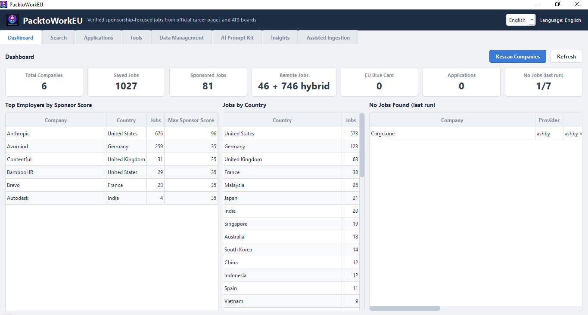

*Screenshots use example data. Your results and available controls depend on
saved data, window size and whether a scan is running. Scroll inside Tools and
Insights to reach lower controls and charts.*

---


# 🇬🇧 English

## 📖 Contents

- **[📸 Screenshots](#-screenshots)** — see every tab before you install
- **[🚀 Quick Start](#-quick-start)** — install, scan, search in three steps
- **[🗂 The Eight Tabs](#-the-eight-tabs)** — the full workspace tour
- [Download](#-download)
- [What It Does](#-what-it-does)
- [Before You Start](#before-you-start)
- [Known issues](issues.md)
- [Scanning](#-scanning)
- [More Help](#more-help)
- [Where Your Data Lives](#-where-your-data-lives)
- [Troubleshooting](#-troubleshooting)
- [Building From Source](#-building-from-source)
- [Requirements](#-requirements)
- [License](#-license)

---

## 📥 Download

To run from source, follow the Python/venv instructions under
[Building From Source](#-building-from-source). No binary build is required.
For a packaged installation, check the
[GitHub Releases page](https://github.com/Kazehaya395/SponsorScout/releases)
for available downloads. The supported package formats are:

| Platform | File |
|----------|------|
| Windows 10 / 11 | `sponsorscout-<version>-setup.exe` |
| Linux (Debian / Ubuntu / Mint) | `sponsorscout_<version>_<arch>.deb` |
| Linux (Fedora / RHEL / openSUSE) | `sponsorscout-<version>-1.<arch>.rpm` |

`<arch>` is your machine's architecture (`amd64` on most desktops, `arm64` on
Raspberry Pi / Graviton). Pick the file for your platform. The app and its
browser are bundled, so no Python is needed.

Installing the Linux packages:

```bash
# Debian / Ubuntu / Mint
sudo apt install ./sponsorscout_<version>_<arch>.deb

# Fedora / RHEL / openSUSE
sudo dnf install ./sponsorscout-<version>-1.<arch>.rpm   # or: sudo zypper install ...
```

Both packages install to `/opt/sponsorscout` and add a launcher plus a desktop
entry; the bundled Chromium is used automatically.

---

## 📸 Screenshots

> **See the whole workspace at a glance.** These show all
> eight tabs. Click any image to open the full-size version.

<table>
  <tr>
    <td align="center"><strong>1 · Dashboard</strong><br><a href="assets/main_dashboard.png"></a></td>
    <td align="center"><strong>2 · Search</strong><br><a href="assets/job_search_table.png">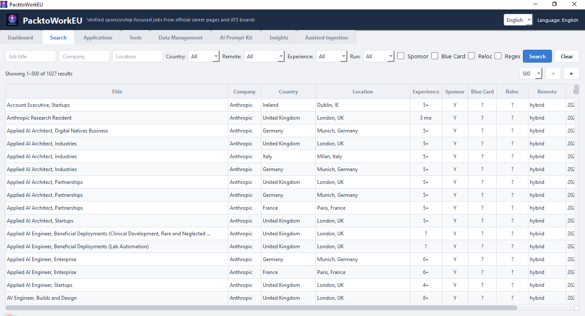</a></td>
  </tr>
  <tr>
    <td align="center"><strong>3 · Applications</strong><br><a href="assets/applications_dashboard.png">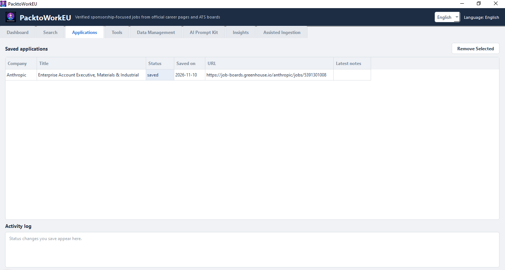</a></td>
    <td align="center"><strong>4 · Tools</strong><br><a href="assets/scanning_tool.png">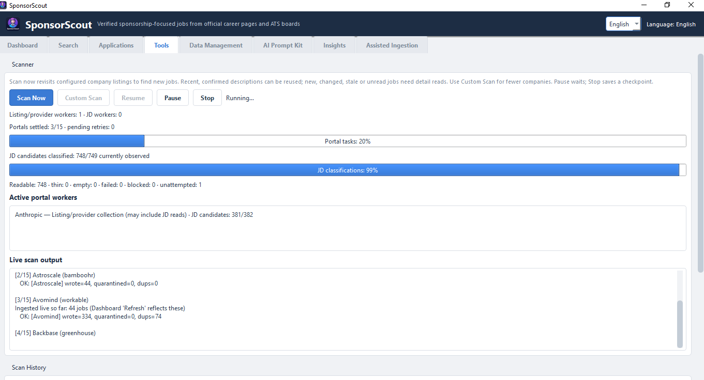</a></td>
  </tr>
  <tr>
    <td align="center"><strong>5 · Data Management</strong><br><a href="assets/backend_data_management.png">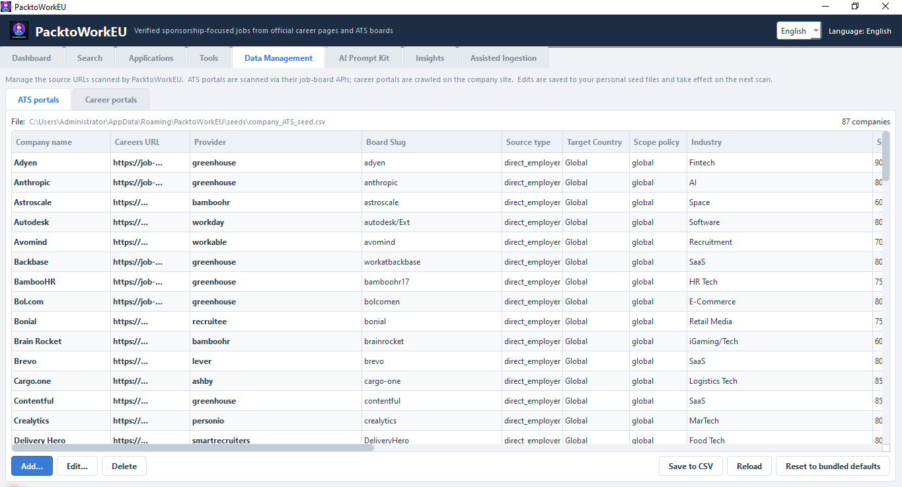</a></td>
    <td align="center"><strong>6 · AI Prompt Kit</strong><br><a href="assets/AI_tailoring_setup.png">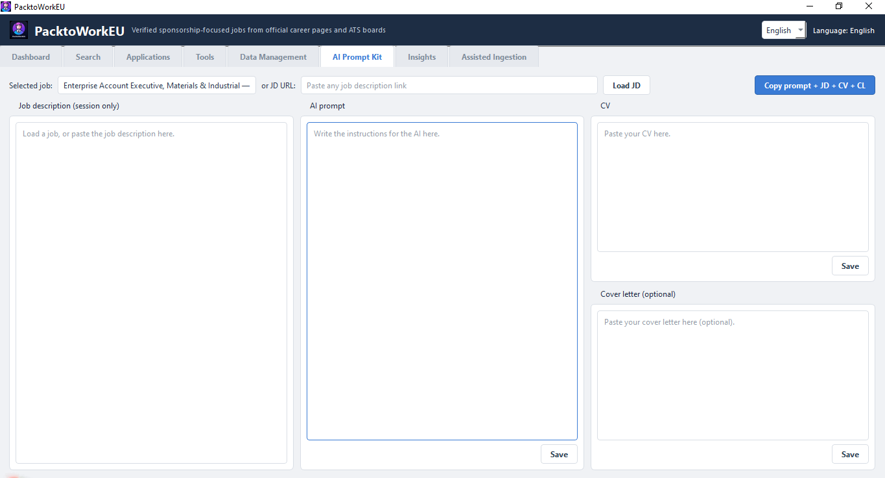</a></td>
  </tr>
  <tr>
    <td align="center"><strong>7 · Insights</strong><br><a href="assets/insights_dashboard.png">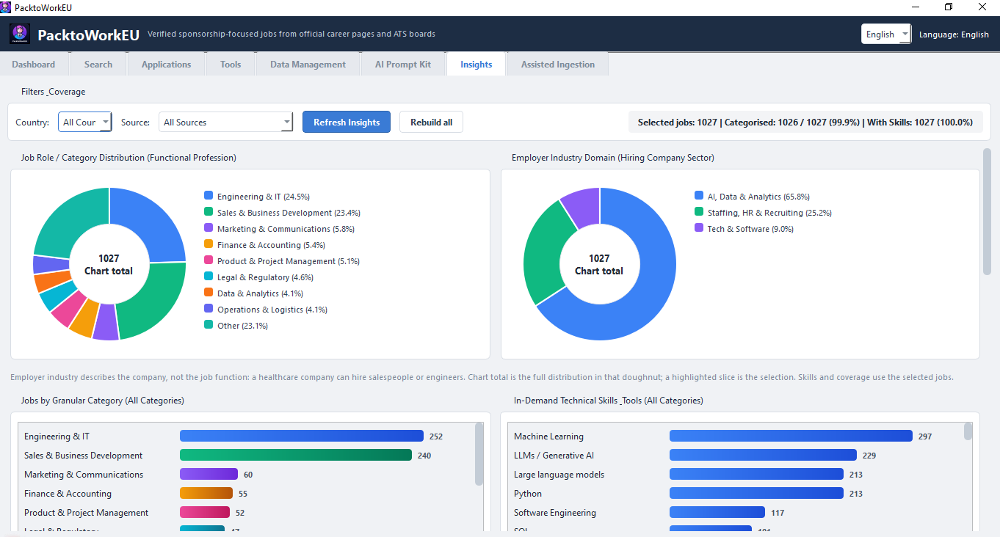</a></td>
    <td align="center"><strong>8 · Assisted Ingestion</strong><br><a href="assets/assisted_ingestion.png">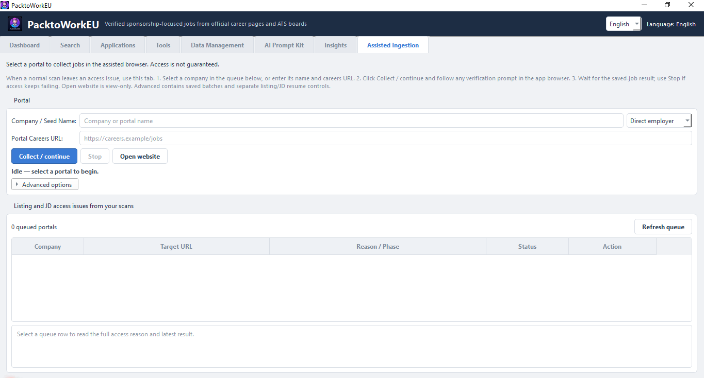</a></td>
  </tr>
</table>

**Bonus — Custom Scan:** choose source types and companies before a targeted run.

<a href="assets/custom_portal_selection.png">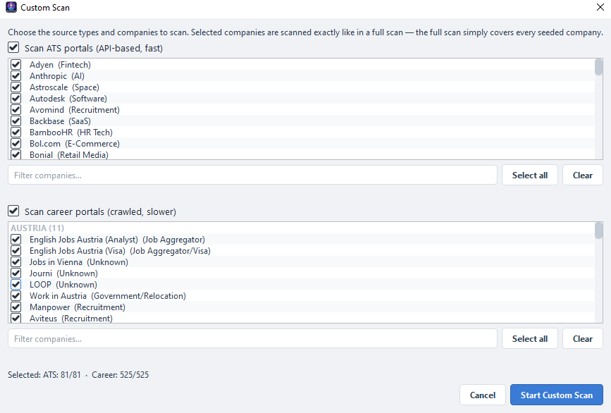</a>

---

## ✨ What It Does

- **Scans seeded job sources** — 10 ATS provider types (Ashby, Greenhouse,
  Lever, SmartRecruiters, Personio, Recruitee, Workable, Workday, Teamtailor,
  BambooHR) through their public job feeds/APIs, plus employer and recruiter
  career boards with a headless browser when needed. A centralised board may
  link to an external employer/aggregator detail page. Providers, access and
  extracted attributes can be incomplete; consult the recorded outcomes.
- **Analyses available job text** — sponsorship, relocation support, remote type and
  EU Blue Card eligibility, detected from the job description.
- **Extracts the experience requirement** — the exact figure the ad states
  (`4+`, `3-5 years`, `6 months`), or the seniority level (`Senior`), read in
  English, German, Italian, Dutch, French, Spanish and Portuguese.
- **Stores app records locally** — SQLite plus local documents/logs. Scanning
  fetches job sites; clipboard text is shared externally only if you paste it.
- **Tracks applications** — Saved → Applied → Interview → Offer → Rejected.
- **Two languages** — English and Italian, switchable at any time.

---

## 🚀 Quick Start

> **New here?** Follow these steps. Later scans can also be slow if descriptions need rereading or access fails.

1. **Run from source** — follow the Python/venv commands under
   [Building From Source](#-building-from-source), then launch the app.
   Separately published installers, if available, are optional and may be older.
2. **Run the first scan** — accept the first-run prompt, or press **Scan Now**
   in **Tools**. A full scan can take minutes to hours depending on how many
   companies are enabled. You can pause, stop and resume without losing the jobs
   already found.
3. **Find and track jobs** — open **Search** to filter by country, title, visa
   sponsorship, EU Blue Card, remote type and regex; save interesting jobs to
   **Applications**.
4. **Go deeper** — open **Insights** for category, skill, domain and
   sponsorship charts, **AI Prompt Kit** to assemble an application prompt, and
   **Assisted Ingestion** for explicit browser collection or access/recovery issues; access is not guaranteed.

Running from source? See [Building From Source](#-building-from-source).

---

## Before You Start

- Start with **Tools → Custom Scan** if you want to try a few companies first.
  **Scan Now** covers the configured company lists.
- Saved job rows and readable descriptions are different. A listing can be saved
  while its description remains unavailable. `?` means Unknown, not No.
- Repeat scans revisit listings and can reuse recent, confirmed descriptions.
  Use the Advanced reread option only when you deliberately want new detail reads.
- **Resume** continues the original campaign's companies, source types and policy.
  Use a new Custom Scan to choose different targets.
- Back up your user-data folder before updating or using cleanup actions.
  See [Where Your Data Lives](#-where-your-data-lives).

---

## 🗂 The Eight Tabs

Use the language selector at the top right to switch English/Italian. Job text,
company names, raw diagnostics and some technical labels are not translated.
The images show current widgets; they are examples, not promised job totals.

| # | Tab | Main purpose | Screenshot |
|---|-----|--------------|------------|
| 1 | [Dashboard](#1-dashboard) | Saved-data overview and latest-run findings | [View](assets/main_dashboard.png) |
| 2 | [Search](#2-search) | Filter, page through and open saved job rows | [View](assets/job_search_table.png) |
| 3 | [Applications](#3-applications) | Edit local application status and notes | [View](assets/applications_dashboard.png) |
| 4 | [Tools](#4-tools) | Scan, resume, inspect progress and history | [View](assets/scanning_tool.png) |
| 5 | [Data Management](#5-data-management) | Edit your ATS/Career company lists | [View](assets/backend_data_management.png) |
| 6 | [AI Prompt Kit](#6-ai-prompt-kit) | Assemble a clipboard message, not generate AI output | [View](assets/AI_tailoring_setup.png) |
| 7 | [Insights](#7-insights) | Explore the selected saved-job data | [View](assets/insights_dashboard.png) |
| 8 | [Assisted Ingestion](#8-assisted-ingestion) | Explicit app-browser collection and recovery | [View](assets/assisted_ingestion.png) |

### 1. Dashboard

The top buttons are **Rescan Companies** and **Refresh**. The seven cards are
**Total Companies**, **Saved Jobs**, **Sponsored Jobs**, **Remote Jobs**,
**EU Blue Card**, **Applications** and **No Jobs (last run)**. This is a saved-data
overview, not a count of every bundled seed or every vacancy on the Internet.
The remote card can show remote and hybrid separately.

Below are **Top Employers by Sponsor Score**, **Jobs by Country** and
**No Jobs Found (last run)**. Employers are ranked by **Max Sponsor Score**, not
by sponsored-job count. A zero sponsorship/Blue Card card means no saved positive
evidence under that metric; it does not turn Unknown into No. The latest-run
no-jobs table also displays status/provider/error information. A blocked or
failed scan is not proof that an employer has no vacancies; inspect the error
and scan history before interpreting the result. **Scan Now** and **Custom Scan** are in Tools, not this action row.


### 2. Search

Enter **Job title**, **Company** or **Location**, choose **Country**, **Remote**,
**Experience** or **Run**, then press **Search**. **Clear** resets the filters.
The **Sponsor**, **Blue Card** and **Reloc** checkboxes ask for positive matches;
they are **not three-way Yes/No/Unknown filter menus**. The results themselves
keep Yes/No/Unknown distinct (`?` means Unknown). **Regex** applies to the three
text fields. Select 100/200/500/1000 rows per page and use **◀ / ▶**; the count
line shows the current page range and total matching rows.

Columns show title, company, country, location, experience, support verdicts,
remote type and first-seen date. Unknown country is not guessed from the seed.
A saved listing row does not prove a full JD was read. Open the original
posting when you need to check information that is unavailable in the saved row.
Double-click a row to open its original website, or right-click for **Open in
browser**, **Copy URL**, **Save to Applications**. Selecting a job supplies the
selection to AI Prompt Kit; use that tab's **Load JD** to load its text.


### 3. Applications

Save a job from Search's right-click menu first. **Saved applications** shows
**Company**, **Title**, **Status**, **Saved on**, **URL** and **Latest notes**.
Select a row to reveal the **Status** dropdown, **Notes**, **Save** and **Cancel**.
The available states are saved, applied, interview, offer and rejected; you choose
them yourself. Saving notes/status does **not** submit an application to an employer.

**Remove Selected** removes the local tracker entry after confirmation.
**Activity log** records status changes made in this session; it is not a permanent
mailbox or a complete historical audit. Saved on is the original saved date,
not an editable interview/follow-up calendar. Status and latest notes persist
in SQLite. **Current limitation:** selecting a row starts the Notes input empty.
Save replaces the stored latest note with that input, including an empty string.
Re-enter an existing note before a status-only save if you want to keep it.


### 4. Tools

The everyday row is **Scan Now**, **Custom Scan**, **Resume**, **Pause**, **Stop**.
Buttons enable/disable according to the current worker and saved checkpoint.
**Pause** suspends work cooperatively; **Stop** asks it to finish safely and retain
saved work. **Resume** continues the original campaign, not a newly selected scope.

During work, separate portal and JD labels/bars, **Active portal workers** and
**Live scan output** show activity. Portal tasks reaching 100% includes partial
and error outcomes: it is not 100% readable JDs or complete site coverage.
After a run the JD bar is hidden and **Final description results** is static:
readable / observed, readable percentage and unresolved count. No JD workers are
running in that finished state. Outcomes retain readable, thin, empty, failed,
blocked and unattempted counts. Observed new/already-saved and description
reused/read-afresh/unresolved are different counters; blocked/inconclusive are
subsets of unresolved, not extra jobs to add to it.

**Scan History** remains visible below (scroll if necessary). Select a run before
**View Per-Company Log** or **Download Scan Log**. The tab opens with
**Advanced maintenance and diagnostics** collapsed. Expand it for **High-Performance
Mode**, **Read saved descriptions again (next new run only)**, **Review alias
merges**, **Clear Stale Data**, **Clear Scan Data**, **Review Quarantine**,
**Review data quality** and **Job Availability Check**. The availability **Run**
checks the chosen sample size; it is separate from forcing description rereads.
Maintenance is explicit, not an automatic scan step. Back up before destructive
cleanup. High-Performance Mode is optional; it does not guarantee speed on old PCs.


### 5. Data Management

Switch between **ATS portals** and **Career portals**. The path and company count
identify your personal CSV, not the bundled file. The grid follows the CSV header;
scroll sideways for remaining fields. **Add…**, **Edit…**, **Delete** change the
working table; **Save to CSV** writes it. **Reload** reloads the saved file.
**Reset to bundled defaults** is an explicit restore action, not routine refresh:
back up custom companies before using it. Edits affect the next new scan; they do
not silently replace the frozen targets of an existing Resume checkpoint.


### 6. AI Prompt Kit

**Selected job** reflects the selected Search row. Alternatively enter **or JD URL**,
then use **Load JD**. It can use saved text or attempt a website read; access can
fail. You can paste a JD manually. The left pane is **Job description (session only)**:
editing/pasting there does not save a new JD into the job database.

The other panes are **AI prompt**, **CV** and **Cover letter (optional)**.
Use each pane's **Save** to persist its text locally; typing alone is not a promise
of persistence. **Copy prompt + JD + CV + CL** copies the current complete message
to the clipboard, in that order. The app does **not** call an AI model, tailor
documents automatically or submit applications. You decide whether to paste the
message into an external AI service; that service's privacy rules then apply.


### 7. Insights

Choose **Country** and **Source**. The coverage line shows **Selected jobs**,
**Categorised** and **With Skills**; these are different measures. Only active,
non-expired jobs in the selected scope contribute. Role/category describes the
job; employer industry describes the company. A health company can hire engineers.

Charts include role/category and employer-industry doughnuts, granular category,
**Technical Skills & Tools**, **Professional / Domain Skills**, **Soft Skills**,
and the sponsorship-by-category table. Scroll down for the lower panels. Click
a slice or bar to cross-filter; click again or clear the active selection to undo.
A doughnut's **Chart total** describes its displayed distribution; the highlighted
slice is a selection. Do not equate either with a global Dashboard total.

**Refresh Insights** updates new/changed saved inputs in the background;
**Rebuild all** asks confirmation to re-extract all saved jobs. During a refresh,
progress and **Cancel refresh** appear; cancel retains committed batches.
**Waiting for ingestion** can appear while normal/Assisted ingestion
has priority. It does not mean there are zero saved jobs. Previously saved charts
may remain visible until ingestion and refresh finish. When comparing totals
across tabs, check the selected filters and whether each view has refreshed.
Skills reflect requirements in available saved text; benefits are excluded.
These charts are not statistics for the entire employment market.


### 8. Assisted Ingestion

Select a queued portal, or enter **Company / Seed Name**, source type and
**Portal Careers URL**. Use **Collect / continue** to begin.
Clicking it explicitly starts the app-controlled Chromium workflow. **Stop**
requests a cooperative stop and keeps committed jobs. **Open website** is
**view-only** in your ordinary browser; it does not collect jobs or share that
browser's cookies/session with SponsorScout. A queue selection alone is not a crawl.

The queue shows **Company**, **Target URL**, **Reason / Phase**, **Status** and
**Action**. Use **Refresh queue** after changes; select a row for its full reason
and latest result. Pending, running, partial and resolved are workflow states,
not proof that every JD or page is readable. During collection, the status shows
progress and saved-job counts. Wait for the final result before interpreting
the collection outcome.

**Advanced options** starts collapsed. Expand it for saved batches, resolved
filtering, detailed results and the separate **Resume unread JDs** / **Resume
listing collection** controls. Resume is limited to the saved scope and observed
continuation evidence. Human-verification controls appear only when an active
session requests them. You perform checks yourself; **Continue after verification**
asks for fresh inspection, not a bypass. Some sites may remain inaccessible;
see [Known issues](issues.md) for current limitations.


---

## 🔍 Scanning

### Full scan

Open **Tools → Scan Now**, or use **Rescan Companies** in Dashboard, to scan the
configured company lists. The app processes selected ATS targets and then Career
targets, saving results locally. A full scan can take minutes to hours depending
on scope, site access and the number of descriptions needing a read.

### Custom scan

Open **Tools → Custom Scan** to choose **ATS portals**, **Career portals**, or both.
Filter the company lists, tick the companies you want, then press **Start Custom
Scan**. It uses the same collection rules as a full scan, but only for that scope.
To check a company you just edited, select it here instead of scanning every list.


### Pause, stop and resume

- **Pause** suspends work at a safe point; use the same control to continue.
- **Stop** requests a safe end and retains successfully saved jobs and a checkpoint.
  A current network operation may need time to return.
- **Resume** continues the original saved campaign, including its selected companies,
  source phases and reread policy. It does not add newly edited companies.
- Start a new Custom Scan when you want a different selection or policy.

Regular scans and Assisted collection cannot run together. Wait for an active
operation to finish or stop before starting another.

### Repeat scans and description rereads

A repeat scan revisits listings to find new and changed jobs. Confirmed active
descriptions captured within the last 24 hours can be reused when observed job
details have not changed. New, changed, stale or unread jobs need detail reads.
A reused description keeps its original capture time.

If you deliberately want new reads, expand **Advanced maintenance and diagnostics**
and enable **Read saved descriptions again (next new run only)**. Confirm when
asked. This applies only to a new run in the chosen scope; access checks and
limits still apply. It does not change an existing Resume checkpoint. A failed
fresh read does not discard authentic saved text. Availability checks are separate.
A change hidden from listing metadata may not be seen until a later or forced read.

### Read progress and results

Portal progress reports work on the selected targets. A settled target can have
complete, partial, empty or error results. The JD section reports whether saved
observations have readable descriptions. Finishing every portal task does not
mean every description was read or every site page was reached.

During work, follow **Active portal workers** and **Live scan output**. At the end,
read **Final description results** and the detailed outcomes. A partial result
keeps useful saved jobs while telling you that collection or enrichment is incomplete.
`Unknown` support is not an employer refusal; check the original ad when needed.

### Assisted collection and human verification

Normal and Custom scans do not open an interactive verification browser by
themselves. If access issues remain, open **Assisted Ingestion**, select the queued
portal (or enter its company and careers URL), then click **Collect / continue**.
You complete any verification yourself in the app-controlled browser.

While the session asks for verification, use **Show verification browser** to
bring it forward and **Continue after verification** to request another check.
Continue does not solve a challenge or guarantee access. Use **Save partial and
close** or **Stop** if you want to end the session and keep committed work.
**Open website** is a separate view-only action in your normal browser; it does
not collect jobs or transfer that browser's session to the app.

### Continue a saved Assisted batch

Expand **Advanced options** in Assisted Ingestion. Select the matching company
and exact careers URL, then use **Load saved batches** and choose the batch.

- **Resume unread JDs** reads unresolved descriptions from that saved selection,
  without collecting the listing again.
- **Resume listing collection** continues an incomplete listing only when a valid
  continuation point was saved. If none is available, start a new collection.

Keep the scan-output folder with your database so saved batches remain available.
A resume does not restore deleted/excluded jobs or merge unrelated batches.

### Inspect history and logs

In **Tools → Scan History**, select a run and use **View Per-Company Log** or
**Download Scan Log**. Logs help distinguish jobs found, jobs saved, access errors,
partial listing collection and unread descriptions. A no-jobs result after an
access error is not proof that an employer has no vacancies.

Raw output is saved under `scan_output/` in the user-data folder. Runs can include
jobs CSVs, error/quarantine CSVs and per-company logs. Keep original files if you
need to investigate or resume a run; they are separate from the current Search view.

### Review countries and data quality

Use **Tools → Advanced maintenance and diagnostics → Review data quality** for
saved rows needing country or non-job review. Optionally enter a company name,
then press **Preview**. Inspect proposed changes, protected rows and unresolved
locations before **Apply reviewed changes**. Applying asks for confirmation and
creates a backup/audit. It is not an automatic scan action.

Country means the observed job country, not the company's headquarters or seed
scope. Unknown locations stay Unknown unless there is reliable saved evidence.
Manual country corrections and saved applications are protected. Excluded non-job
rows leave the active search view without erasing their stored evidence.

### Cleanup and backups

Advanced maintenance includes alias-merge review, stale-data cleanup, scan-data
cleanup and quarantine review. Read each preview or confirmation carefully and
back up the user-data folder before destructive actions. Alias merging requires
explicit review; ordinary scans do not automatically clean up your database.

Maintenance backups are stored in `maintenance_backups/` beside the database.
To restore one, close SponsorScout first, retain your current database separately,
and restore the selected backup. Never replace an open SQLite database.

For implementation details and data-file formats, see the
[Codebase Guide](SponsorScout_codebase_guide.md).

---

## 💾 Where Your Data Lives

| Platform | Location |
|----------|----------|
| Windows | `%APPDATA%\SponsorScout` |
| Linux | `~/.sponsorscout` |

Contains `sponsorscout.db` (jobs, companies, applications, scan history),
`seeds/` (your editable company lists), `locale.json` (language) and raw scan
logs under `scan_output/`.

Close the app, then back up the **whole user-data folder**, including seeds,
documents and scan history. A live SQLite database can also have WAL/SHM sidecars;
copying only its `.db` while the app runs is not a complete backup.
Set `SPONSORSCOUT_DATA_DIR` or `SPONSORSCOUT_DB_PATH` **before launching** to
override the paths. A separately located custom database needs its own backup.

### Uninstalling

**Source/venv users:** deleting a source checkout or its venv is not running an
uninstaller. Keep your separate user-data folder unless you deliberately want
to remove it. The following warnings apply to packaged uninstallers.


The Windows installer, the Linux `.deb` and the Linux `.rpm` all remove
SponsorScout-owned user data when the app is uninstalled — the SQLite database,
editable seeds, language setting and scan logs. The default locations are
cleaned for the current Windows user and for local Linux user accounts. Custom
data paths are also removed when their `SPONSORSCOUT_DATA_DIR` /
`SPONSORSCOUT_DB_PATH` environment variables are available to the uninstaller.
Back up anything you want to keep before uninstalling. The shared Playwright
browser cache is not removed because other applications may use it.

On Linux the two packages behave identically; `apt remove sponsorscout` /
`dnf remove sponsorscout` does the same as the Windows uninstaller.

---

## 🧰 Troubleshooting

**The Dashboard looks empty after a scan.** Click **Refresh**. If still empty,
check the newest **Scan History** row — an `error` status, or failures in its
log, shows which companies returned nothing.

**"Playwright is required for DOM fallback" / "Chromium browser is not
available".** Career pages are crawled with Playwright, and installers bundle
both the library and Chromium. To see exactly what is wrong in an installed
build, run:

```bash
/opt/sponsorscout/SponsorScout --self-check --self-check-browser
"C:\Program Files\SponsorScout\SponsorScout.exe" --self-check --self-check-browser
```

It reports whether `playwright` imports (including *why* it fails, e.g. a
missing `greenlet`), where Playwright looks for browsers, and whether the
bundled Chromium launches — without opening the app. Builds run this
automatically and refuse to package a broken bundle. From source, run
`python -m playwright install chromium`.

**SponsorScout will not download a browser by itself.** If Chromium is missing
the app logs a warning and keeps working, but JS-rendered career pages return 0
jobs. Install it once with `python -m playwright install chromium`. To restore
the old automatic behaviour set `SPONSORSCOUT_AUTO_INSTALL_BROWSERS=1` — it is
off by default because a large browser download can block the scan for minutes.
Installed builds are unaffected: the browser ships inside the `.exe`, `.deb`
and `.rpm`.

**A seed row contains an error.** Scan startup does not run a whole-seed
validation pass. Custom scans select companies before processing their rows;
a malformed selected URL is logged as that company's error without blocking
the other companies. Correct it in **Data Management**. The Scan button never
rewrites your seed or upgrades its URLs behind your back.

**Some companies returned no jobs.** Check that seed's scan log and errors
CSV. `empty` is **not** proof that a portal has no jobs: the site may have
served a different response, failed to render cards, or returned an explicit
server error (reported as `error` when observed). See [Known issues](issues.md)
for current limitations.
Do not assume a verification wall from a failed page or bypass one.

**The scan is slow.** The detail-page pass is the slow part, and it is bounded:
SponsorScout sizes its browser pool from your CPU/RAM, runs at below-normal
priority, and blocks images/fonts/media while crawling. The Dashboard stays
usable. You do not have to wait it out — press **Pause** to suspend the scan
at cooperative checkpoints (saved work is retained) and click the same button
again to request continuation. **Stop** ends the run and keeps everything found,
and **Resume** later continues the unfinished companies, even after restarting
the app.

**A portal is blocked by human verification.** Normal/custom scans finish
unattended without opening a visible browser. Read the one finish notice,
then use the persistent **Assisted Ingestion** queue when ready. Its explicit
launch opens Chromium for your verification and saves each successful job;
**Open website** there is a separate manual browsing action.

**Insights is refreshing slowly.** The first pass on existing full JDs may
still take time; processed/total and committed coverage show real progress.
Later refreshes process only changed/new inputs (valid Unknown results are not
retried endlessly). A scan has priority; the worker shows **Waiting for ingestion**.
Use **Cancel refresh** to keep saved batches. Missing packaged taxonomy assets
produce a visible error rather than a growing regex/retry loop.

**A job shows `?`.** `?` means *unknown*, never *no*. A readable ad may be
silent about support, or the JD may still be unread/blocked/deferred. Check JD
coverage before interpreting it; SponsorScout does not invent a refusal.
Unknown jobs are never removed.

**Can I scan only some companies?** Yes — **Tools → Custom Scan**. Same
quality, only the scope changes.

**How do I search with a regular expression?** Tick **Regex** in **Search** and
type a pattern such as `(backend|platform).*engineer`. Case-insensitive; an
invalid pattern warns and falls back to a normal search.

**Does anything leave my computer?** Scanning and JD loading contact websites;
those sites and their embedded services receive ordinary request/network data.
SponsorScout does not automatically upload your stored CV/notes to an AI service.
Clipboard content leaves the app if you paste/share it elsewhere. **Open website**
uses your external browser and that browser’s ordinary network/session behaviour.

---

## 🏗 Building From Source

### Run from Python + venv (no binary build needed)

From the extracted folder containing `pyproject.toml`, with Python 3.10+:

```powershell
# Windows PowerShell — activation is optional with explicit interpreter paths
py -3 -m venv .venv
.\.venv\Scripts\python.exe -m pip install --upgrade pip
.\.venv\Scripts\python.exe -m pip install -e .
.\.venv\Scripts\python.exe -m playwright install chromium
.\.venv\Scripts\python.exe -m sponsorscout.main
```

```bash
# Linux
python3 -m venv .venv
.venv/bin/python -m pip install --upgrade pip
.venv/bin/python -m pip install -e .
.venv/bin/python -m playwright install chromium
.venv/bin/python -m sponsorscout.main
```

On supported Linux systems, Chromium may also need system libraries:
`.venv/bin/python -m playwright install --with-deps chromium` (may require admin
privileges). Native Qt libraries and a desktop session are needed for normal GUI use.
For startup diagnostics use `python -m sponsorscout.main --self-check` and
`python -m sponsorscout.main --self-check-browser` with that same venv interpreter.
Do **not** use `python -m sponsorscout`: this tree has no `__main__.py`.
After moving to a new checkout, reinstall `-e .` in the intended venv so an older
editable install does not point at the wrong source folder. No source update
requires deleting your database.

### Optional native packaging and tests

You do not need the following build steps to run from a terminal/venv.


```powershell
python -m venv venv
venv\Scripts\activate
pip install -r requirements.txt   # runtime + pyinstaller (used by the build scripts)
pip install -e ".[dev]"          # pytest, for the test suite
python -m playwright install chromium
```

`requirements.txt` is what the build scripts (`build_exe.ps1`, `build_deb.sh`,
`build_rpm.sh`) consume, so it must keep `pyinstaller`. The `.[dev]` extra adds
`pytest` for the suite; `pip install -e .` alone is enough if you only want to
run the app.

If you skip `playwright install chromium`, the app can still start but
browser-dependent reads can fail or yield no jobs; inspect the reported error. It will **not** download the browser on its
own; set `SPONSORSCOUT_AUTO_INSTALL_BROWSERS=1` if you want that behaviour back.

**Windows installer:**
```powershell
.\build_exe.ps1               # -> dist\sponsorscout-<version>-setup.exe
```
(requires Inno Setup 6/7; bundles Playwright Chromium)

**Linux package (Debian / Ubuntu):**
```bash
./build_deb.sh                # -> dist/sponsorscout_<version>_<arch>.deb
```
Run it as your normal user: **do not use `sudo`**. The script creates an
isolated build environment in `.build/deb-venv`, so it never modifies the
system Python. If Python's venv module is missing, install it once with
`sudo apt install python3-venv`, then run `./build_deb.sh` again.
Packaging the ~1.4 GB payload (PySide6 + bundled Chromium) is the slow step and
prints how long it took; the `.deb` only appears in `dist/` once it is complete.
For a much faster build that requires dpkg >= 1.21.18 to install, use
`DEB_COMPRESSION=zstd ./build_deb.sh`.
Building from a Windows drive mounted in WSL (`/mnt/c/...` and friends) is not
recommended: those filesystems cannot store Unix permissions, so the build
detects it and stages the package in `/tmp`. For the fastest and most
reliable build, copy the project to a Linux filesystem such as `~/sponsorscout`.

**Linux package (Fedora / RHEL / openSUSE — RPM):**
```bash
./build_rpm.sh               # -> dist/sponsorscout-<version>-1.<arch>.rpm
```
Same rules as the `.deb`: run it as your normal user (**do not use `sudo`**)
and let it create the isolated `.build/rpm-venv`. Requires `rpmbuild`
(`sudo dnf install rpm-build` on Fedora/RHEL, `sudo apt install rpm` on
Debian/Ubuntu/WSL, `sudo zypper install rpm-build` on openSUSE). It bundles
Playwright Chromium, smoke-tests the binary and never strips the bundled
C-extensions — exactly like `build_deb.sh`. The payload compressor is probed
on your machine (fast xz by default); for a smaller package where every
target has rpm >= 4.14, use `RPM_COMPRESSION=zstd ./build_rpm.sh`. Like the
other two scripts it leaves `dist/` alone apart from its own output, so the
`.exe`, `.deb` and `.rpm` can be built side by side.

**Tests:**
```bash
python -m pytest sponsorscout/tests
```

---

---

## More Help

- [Known issues](issues.md) — current bugs and practical limitations.
- [Codebase Guide](SponsorScout_codebase_guide.md) — architecture, file formats,
  development and maintenance details.

---

## 📋 Requirements

- Python 3.10 or newer to run from source (packaged installers do not require Python)
- Runtime: **PySide6-Essentials** (not the full meta-package), **requests**, **truststore**, **playwright** (`requirements.txt`)
- Playwright Chromium: `python -m playwright install chromium`
- Dev/test: **pytest**, **pyinstaller** (`pip install ".[dev]"`)
- Linux packaging: `python3`, `python3-venv`, and `dpkg` (`sudo apt install python3-venv`); `rpmbuild` for the `.rpm` (`sudo dnf install rpm-build` / `sudo apt install rpm`)
- Optional: `SPONSORSCOUT_AUTO_INSTALL_BROWSERS=1` lets the app download Chromium itself when it is missing (off by default)

---

## 📄 License

MIT — see [LICENSE](LICENSE).

Location reference data includes information from [GeoNames](https://www.geonames.org/),
licensed under [CC BY 4.0](https://creativecommons.org/licenses/by/4.0/).
Source and attribution details are included in `sponsorscout/data/location_places.json`.

---


# 🇮🇹 Italiano

## 📖 Indice

- **[📸 Schermate](#-schermate)** — tutte le schede prima dell'installazione
- **[🚀 Avvio Rapido](#-avvio-rapido)** — installa, scansiona, cerca in tre passi
- **[🗂 Le Otto Schede](#-le-otto-schede)** — il tour completo dell'app
- [Scarica](#-scarica)
- [Cosa Fa](#-cosa-fa)
- [Prima di iniziare](#prima-di-iniziare)
- [Problemi noti](issues.md)
- [Scansione](#-scansione)
- [Altre informazioni](#altre-informazioni)
- [Dove Sono i Tuoi Dati](#-dove-sono-i-tuoi-dati)
- [Risoluzione Problemi](#-risoluzione-problemi)
- [Compilare dai Sorgenti](#-compilare-dai-sorgenti)
- [Requisiti](#-requisiti)
- [Licenza](#-licenza)

---

## 📥 Scarica

Per avviare dai sorgenti, segui le istruzioni Python/venv in
[Compilare dai Sorgenti](#-compilare-dai-sorgenti): non serve creare un binario.
Per installare un pacchetto, controlla i download disponibili nella
[pagina GitHub Releases](https://github.com/Kazehaya395/SponsorScout/releases).
I formati supportati sono:

| Piattaforma | File |
|-------------|------|
| Windows 10 / 11 | `sponsorscout-<versione>-setup.exe` |
| Linux (Debian / Ubuntu / Mint) | `sponsorscout_<versione>_<arch>.deb` |
| Linux (Fedora / RHEL / openSUSE) | `sponsorscout-<versione>-1.<arch>.rpm` |

`<arch>` è l'architettura della tua macchina (`amd64` sulla maggior parte dei
desktop, `arm64` su Raspberry Pi / Graviton). Scegli il file per la tua
piattaforma. L'app e il browser sono inclusi, quindi non serve Python.

Installare i pacchetti Linux:

```bash
# Debian / Ubuntu / Mint
sudo apt install ./sponsorscout_<versione>_<arch>.deb

# Fedora / RHEL / openSUSE
sudo dnf install ./sponsorscout-<versione>-1.<arch>.rpm   # oppure: sudo zypper install ...
```

Entrambi i pacchetti installano in `/opt/sponsorscout` e aggiungono un launcher
più una voce nel menu applicazioni; il Chromium incluso viene usato
automaticamente.

---

## 📸 Schermate

> **Tutta l'app a colpo d'occhio.** Queste sono catture aggiornate delle otto
> schede. Clicca un'immagine per aprirla a dimensione piena.

Le schermate usano dati di esempio. Risultati e comandi disponibili dipendono
dai dati salvati, dalla dimensione della finestra e dalle operazioni in corso.
Scorri Strumenti e Approfondimenti per raggiungere i pannelli inferiori.

<table>
  <tr>
    <td align="center"><strong>1 · Pannello</strong><br><a href="assets/main_dashboard_it.png">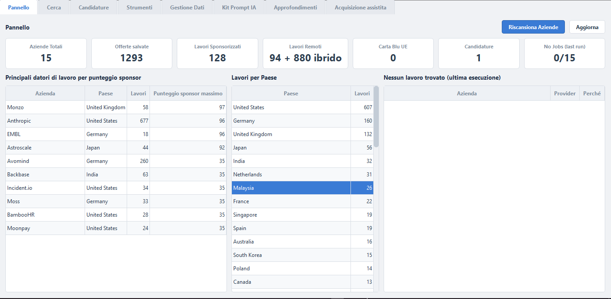</a></td>
    <td align="center"><strong>2 · Cerca</strong><br><a href="assets/job_search_table_it.png">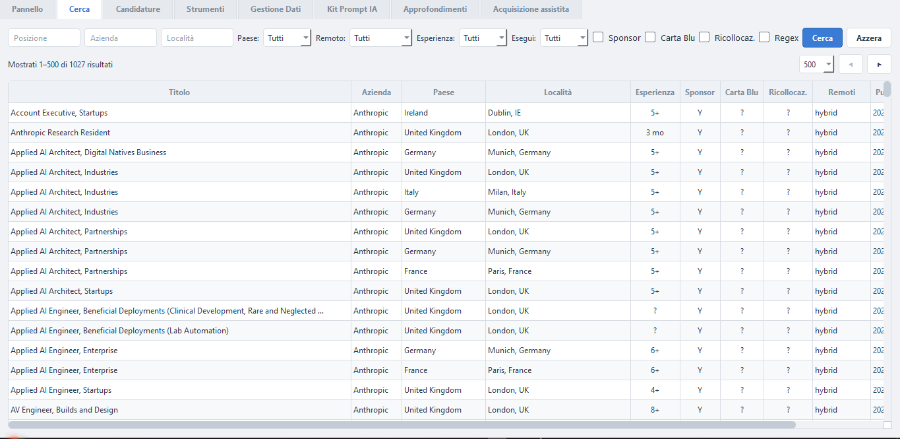</a></td>
  </tr>
  <tr>
    <td align="center"><strong>3 · Candidature</strong><br><a href="assets/applications_dashboard_it.png">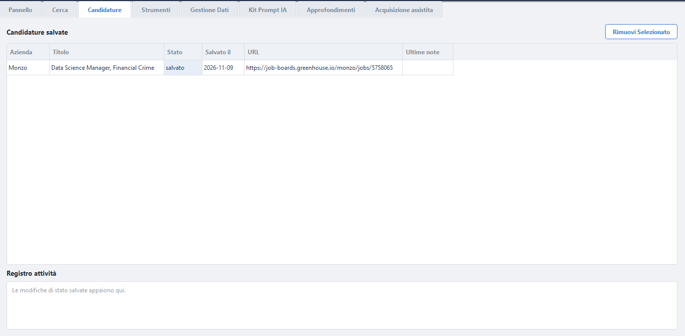</a></td>
    <td align="center"><strong>4 · Strumenti</strong><br><a href="assets/scanning_tool_it.png">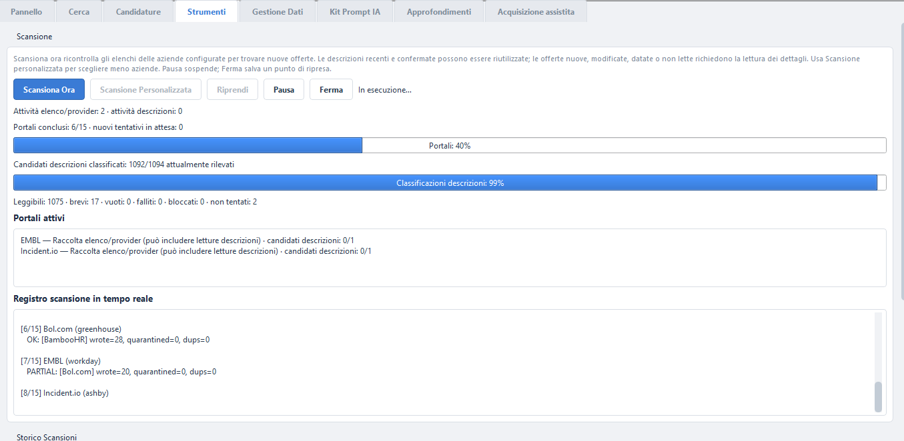</a></td>
  </tr>
  <tr>
    <td align="center"><strong>5 · Gestione Dati</strong><br><a href="assets/backend_data_management_it.png">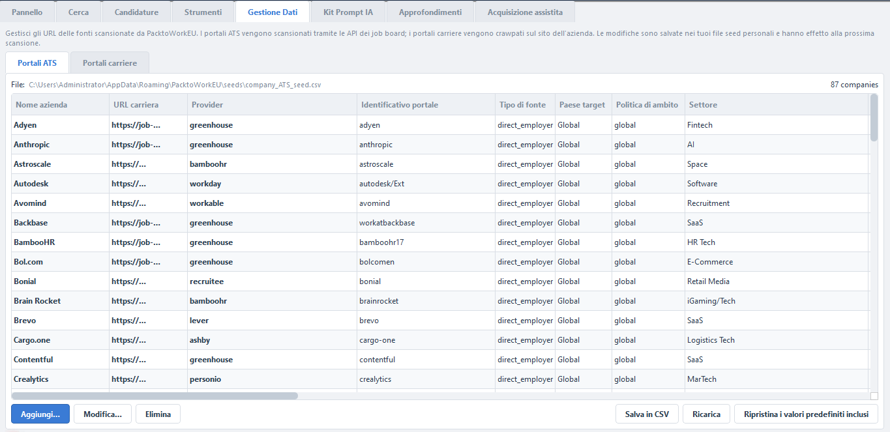</a></td>
    <td align="center"><strong>6 · Kit Prompt IA</strong><br><a href="assets/AI_tailoring_setup_it.png">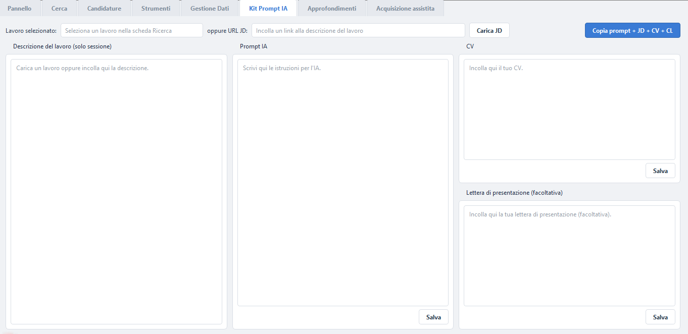</a></td>
  </tr>
  <tr>
    <td align="center"><strong>7 · Approfondimenti</strong><br><a href="assets/insights_dashboard_it.png">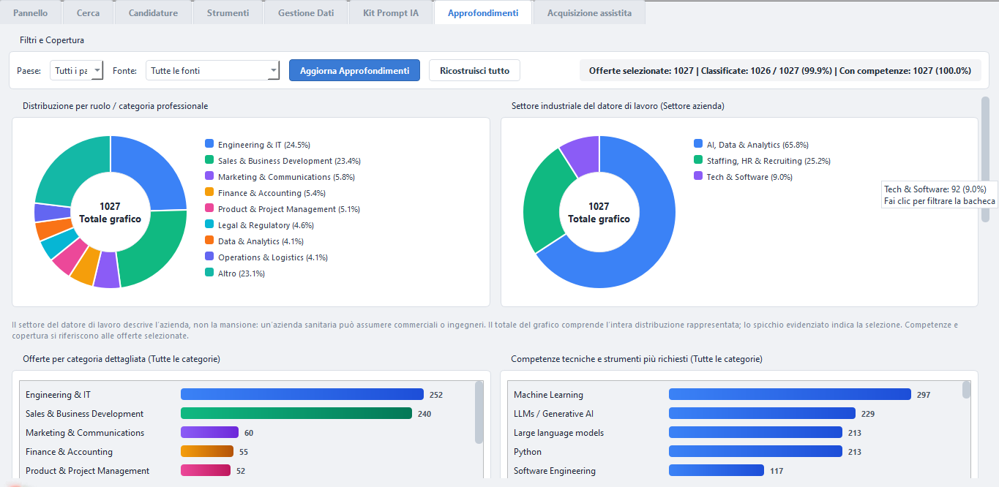</a></td>
    <td align="center"><strong>8 · Acquisizione Assistita</strong><br><a href="assets/assisted_ingestion_it.png">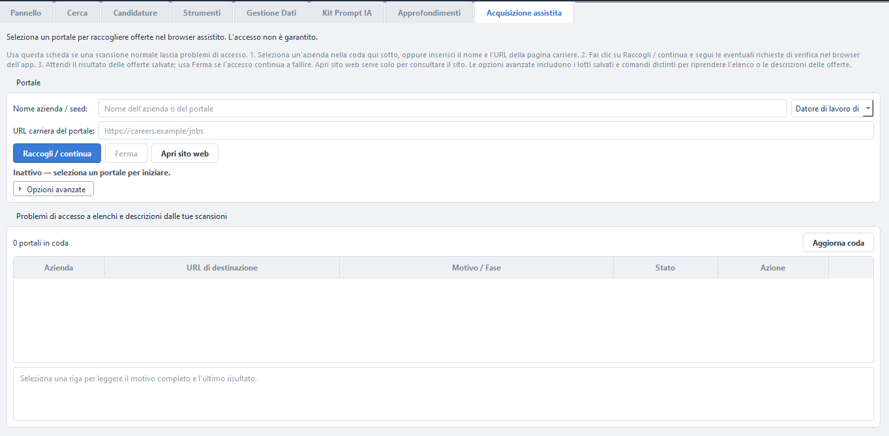</a></td>
  </tr>
</table>

**Extra — Scansione personalizzata:** scegli tipi di fonte e aziende prima di
un'esecuzione mirata.

<a href="assets/custom_portal_selection_it.png">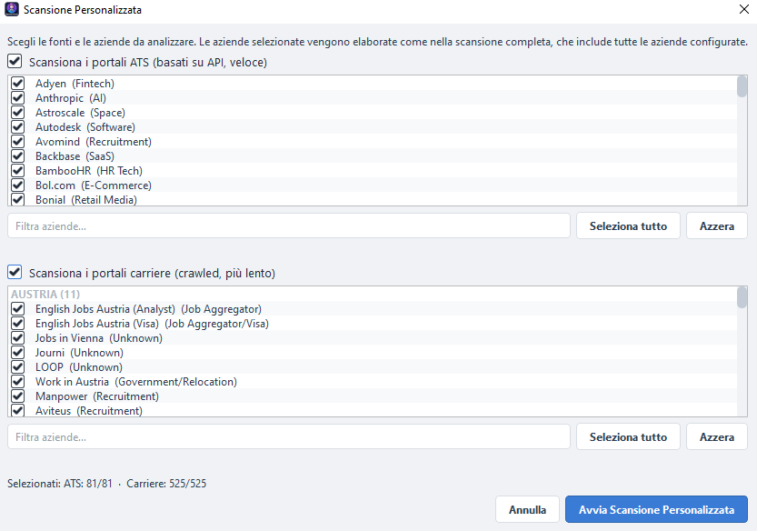</a>

---

## ✨ Cosa Fa

- **Scansiona le fonti configurate** — 10 tipi di provider ATS (Ashby,
  Greenhouse, Lever, SmartRecruiters, Personio, Recruitee, Workable, Workday,
  Teamtailor, BambooHR) tramite feed/API pubbliche, più le pagine carriera di
  aziende e recruiter con un browser headless quando necessario. Un portale
  centralizzato può rimandare a una scheda lavoro su un altro sito.
- **Analizza il testo disponibile** — sponsorizzazione, trasferimento, tipo di lavoro
  remoto e idoneità alla Carta Blu UE, rilevati dalla descrizione.
- **Estrae l'esperienza richiesta** — la cifra esatta indicata
  (`4+`, `3-5 anni`, `6 mesi`), oppure il livello di seniority (`Senior`),
  riconosciuta in inglese, tedesco, italiano, olandese, francese, spagnolo e
  portoghese.
- **Conserva i dati dell’app in locale** — SQLite, documenti e log. Le letture
  contattano siti esterni; condividi il testo degli appunti solo se lo incolli.
- **Gestisce le candidature** — Salvata → Inviata → Colloquio → Offerta →
  Rifiutata.
- **Due lingue** — Italiano e Inglese, selezionabili in qualsiasi momento.

---

## 🚀 Avvio Rapido

> **È la prima volta?** Segui questi passi. Anche le successive possono richiedere tempo se servono nuove letture o l’accesso fallisce.

1. **Avvia dai sorgenti** — segui i comandi Python/venv in
   [Compilare dai Sorgenti](#-compilare-dai-sorgenti), poi avvia l’app. Gli
   installer pubblicati separatamente sono facoltativi e possono essere vecchi.
2. **Esegui la prima scansione** — accetta la richiesta al primo avvio, oppure
   premi **Scansiona Ora** in **Strumenti**. Una scansione completa può richiedere
   da pochi minuti a ore in base alle aziende attive. Puoi mettere in pausa,
   fermare e riprendere senza perdere le offerte già trovate.
3. **Trova e gestisci le offerte** — apri **Cerca** per filtrare per paese,
   titolo, sponsorizzazione del visto, Carta Blu UE, modalità remota e regex;
   salva le offerte interessanti in **Candidature**.
4. **Approfondisci** — apri **Approfondimenti** per i grafici su categorie,
   competenze, settori e sponsorizzazione, **Kit Prompt IA** per preparare un
   messaggio di candidatura e **Acquisizione assistita** per raccolta esplicita e problemi di accesso o ripresa,
   senza garanzia che la verifica riesca.

Esegui dai sorgenti? Vedi [Compilare dai Sorgenti](#-compilare-dai-sorgenti).

---

## Prima di iniziare

- Usa **Strumenti → Scansione Personalizzata** per iniziare con poche aziende.
  **Scansiona Ora** copre gli elenchi di aziende configurati.
- Offerte salvate e descrizioni leggibili sono cose diverse. Un'offerta può
  essere salvata senza una JD disponibile. `?` significa Sconosciuto, non No.
- Le scansioni successive ricontrollano gli elenchi e possono riutilizzare JD
  recenti e confermate. Usa la rilettura avanzata solo se vuoi nuove letture.
- **Riprendi** mantiene aziende, tipi di fonte e politica della campagna originale.
  Per cambiare ambito avvia una nuova Scansione Personalizzata.
- Salva la cartella dei dati prima di aggiornare o usare la pulizia.
  Vedi [Dove Sono i Tuoi Dati](#-dove-sono-i-tuoi-dati).

---

## 🗂 Le Otto Schede

Il selettore in alto a destra cambia lingua. Testi delle offerte, nomi delle aziende,
diagnostica grezza e alcune etichette tecniche non vengono tradotti. Le schermate
italiane provengono dai widget attuali con dati fittizi, non da risultati promessi.

| # | Scheda | Uso principale | Schermata |
|---|--------|----------------|-----------|
| 1 | [Pannello](#1-pannello) | Dati salvati ed esiti dell'ultima esecuzione | [Vedi](assets/main_dashboard_it.png) |
| 2 | [Cerca](#2-cerca) | Filtrare e aprire le offerte salvate | [Vedi](assets/job_search_table_it.png) |
| 3 | [Candidature](#3-candidature) | Stato e note delle candidature locali | [Vedi](assets/applications_dashboard_it.png) |
| 4 | [Strumenti](#4-strumenti) | Scansioni, ripresa, avanzamento e cronologia | [Vedi](assets/scanning_tool_it.png) |
| 5 | [Gestione Dati](#5-gestione-dati) | Elenchi personali ATS/Career | [Vedi](assets/backend_data_management_it.png) |
| 6 | [Kit Prompt IA](#6-kit-prompt-ia) | Preparare testo da copiare, non generare risposte IA | [Vedi](assets/AI_tailoring_setup_it.png) |
| 7 | [Approfondimenti](#7-approfondimenti) | Analizzare le offerte salvate selezionate | [Vedi](assets/insights_dashboard_it.png) |
| 8 | [Acquisizione assistita](#8-acquisizione-assistita) | Raccolta esplicita con il browser dell'app | [Vedi](assets/assisted_ingestion_it.png) |

### 1. Pannello

I pulsanti in alto sono **Riscansiona Aziende** e **Aggiorna**, non Scansiona Ora
e Scansione Personalizzata (che sono in Strumenti). Le sette card mostrano aziende,
offerte salvate, lavori sponsorizzati, remoti, Carta Blu UE, candidature e
**No Jobs (last run)**; quest'ultima etichetta tecnica può restare in inglese.
La card remoti può distinguere remoti e ibridi. Non sono conteggi di tutti i seed
o di tutte le offerte pubblicate su Internet.

Sotto trovi i principali datori per punteggio sponsor, i lavori per paese e
**Nessun lavoro trovato (ultima esecuzione)**. La classifica usa il punteggio
sponsor massimo, non il numero di lavori sponsorizzati. Zero evidenze positive
non significa che gli Sconosciuti siano No. La tabella dell'ultima esecuzione
mostra anche provider, stato ed errori. Un accesso bloccato o una scansione
fallita non dimostrano che l’azienda non abbia offerte: controlla errore e
cronologia in Strumenti.


### 2. Cerca

Inserisci titolo, azienda o località e scegli **Paese**, **Remoto**, **Esperienza**
o **Esegui** (esecuzione); premi **Cerca**. **Azzera** ripristina i filtri.
Le caselle **Sponsor**, **Carta Blu** e **Ricollocaz.** richiedono risultati
positivi: non sono menu a tre stati. Nelle righe restano distinti Sì, No e `?`
(Sconosciuto). **Regex** agisce sui tre campi testuali. Scegli 100/200/500/1000
righe per pagina e usa **◀ / ▶**; il testo sopra indica intervallo e totale.

Le colonne mostrano titolo, azienda, paese, località, esperienza, verdetti di
supporto, modalità remota e prima osservazione. Il paese sconosciuto non viene
inventato dal seed. Una riga salvata non prova che la JD sia leggibile: apri il sito originale
per controllare le informazioni non disponibili nella riga salvata.
Doppio clic apre il sito originale; il menu con tasto destro permette di aprire,
copiare l'URL o salvare in Candidature. La selezione passa al Kit Prompt IA;
usa **Carica JD** in quella scheda per leggere il testo.


### 3. Candidature

Salva prima un'offerta dal menu di Cerca. **Candidature salvate** mostra azienda,
titolo, stato, data di salvataggio, URL e ultime note. Seleziona una riga per
aprire **Stato**, **Note**, **Salva** e **Annulla**. Gli stati salvata, inviata,
colloquio, offerta e rifiutata sono scelti da te: cambiare stato non invia
nessuna candidatura al datore di lavoro.

**Rimuovi Selezionato** elimina la voce locale dopo conferma. Il **Registro
attività** registra modifiche di stato della sessione corrente, non una cronologia
permanente completa. La data è quella originale del salvataggio, non un calendario
modificabile di colloqui o solleciti. Stato e ultime note restano in SQLite. **Limite attuale:** selezionare una riga
lascia vuoto il campo Note. Salva sostituisce l’ultima nota anche con testo vuoto.
Reinserisci la nota precedente prima di salvare solo uno stato se vuoi
conservarla.


### 4. Strumenti

I comandi quotidiani sono **Scansiona Ora**, **Scansione Personalizzata**,
**Riprendi**, **Pausa**, **Ferma**. Si abilitano secondo lo stato del worker e
del punto di ripresa. Pausa e Ferma sono cooperative; Ferma conserva il lavoro
salvato. Riprendi continua aziende, fasi e politica della campagna originale.

Durante il lavoro sono separati avanzamento dei portali e delle descrizioni,
**Portali attivi** e **Registro scansione in tempo reale**. Il 100% dei portali
include anche errori e risultati parziali: non significa 100% di JD leggibili.
A fine esecuzione la barra JD scompare; il risultato statico mostra leggibili /
osservate, percentuale e irrisolte. In quello stato non ci sono worker JD attivi.
Restano i dettagli leggibili, brevi, vuote, fallite, bloccate e non tentate.
Nuove/già salvate e riutilizzate/rilette/irrisolte sono misure diverse; bloccate e
inconcludenti sono sottoinsiemi delle irrisolte, non righe aggiuntive.

La cronologia resta sotto: scorri e seleziona un'esecuzione prima di **Vedi
Registro per Azienda** o **Scarica Registro di Scansione**.
**Manutenzione e diagnostica avanzate** parte chiusa. Dentro ci sono modalità
alte prestazioni, rilettura delle descrizioni solo per la prossima nuova esecuzione,
revisione fusioni alias, pulizia dati obsoleti/di scansione, quarantena, revisione
qualità e controllo disponibilità. Il controllo disponibilità di un campione
è distinto dalla rilettura delle JD. Le operazioni di manutenzione sono esplicite;
fai un backup prima di eliminazioni. Nessuna velocità garantita sui PC datati.


### 5. Gestione Dati

Scegli la sotto-scheda ATS o Career. Percorso e conteggio identificano il tuo CSV
personale; la griglia segue le sue intestazioni e può richiedere scorrimento
orizzontale. **Aggiungi…**, **Modifica…**, **Elimina** cambiano la tabella;
**Salva in CSV** scrive il file, **Ricarica** rilegge quello salvato.
**Ripristina i valori predefiniti inclusi** ripristina esplicitamente i seed:
salva prima le aziende personalizzate. Le modifiche valgono per la prossima nuova
scansione, non sostituiscono di nascosto l'ambito congelato di Riprendi.


### 6. Kit Prompt IA

**Lavoro selezionato** deriva dalla riga scelta in Cerca. Puoi invece usare
**oppure URL JD**, poi **Carica JD**. L'app usa il testo salvato oppure tenta
la lettura del sito; l'accesso può fallire. Puoi incollare la JD. Il riquadro
sinistro è solo di sessione: modificarlo non salva una nuova JD nel database.

Gli altri riquadri sono prompt IA, CV e lettera facoltativa. Usa **Salva** per
ciascun documento da conservare localmente: scrivere da solo non garantisce il
salvataggio. **Copia prompt + JD + CV + CL** prepara il messaggio completo negli
appunti in quell'ordine. Non chiama un modello IA, non genera documenti e non
invia candidature. Sei tu a decidere se incollare i dati in un servizio esterno,
con le sue regole di privacy.


### 7. Approfondimenti

Scegli **Paese** e **Fonte**. **Offerte selezionate**, **Classificate** e
**Con competenze** misurano cose diverse. Contribuiscono solo le offerte attive,
non scadute, nell'ambito scelto. La categoria descrive la mansione, il settore
l'azienda: un datore sanitario può assumere ingegneri o commerciali.

Trovi grafici a ciambella per mansione e settore, categoria dettagliata, competenze
tecniche/strumenti, professionali/di dominio, trasversali e tabella sponsor per
categoria. Scorri per i pannelli inferiori. Clic su spicchio/barra filtra la
scheda; ripeti il clic o annulla la selezione per toglierlo. Il totale nella
ciambella è la distribuzione mostrata, non necessariamente tutte le offerte del
Pannello. Lo spicchio evidenziato è la selezione.

**Aggiorna Approfondimenti** elabora input salvati nuovi o modificati;
**Ricostruisci tutto** richiede conferma per rielaborare tutto. Durante il lavoro
compaiono avanzamento e annullamento; i lotti già salvati restano. Un messaggio
di attesa della raccolta indica che la scansione normale/assistita ha precedenza:
non significa che non ci siano offerte salvate.
I grafici possono mostrare l'ultimo stato consolidato fino al termine del lavoro.
Prima di confrontare i totali delle schede, controlla i filtri selezionati
e che ogni vista abbia completato il proprio aggiornamento.
I benefit non sono requisiti professionali. Non è una statistica di tutto il mercato.


### 8. Acquisizione assistita

Scegli una riga in coda oppure inserisci **Nome azienda / seed**, tipo di fonte e
**URL carriera del portale**. Usa **Raccogli / continua** per iniziare. Avvia esplicitamente Chromium controllato dall'app. **Ferma** chiede
l'arresto cooperativo conservando i dati già salvati. **Apri sito web** serve
solo a consultare nel browser normale: non raccoglie offerte e non condivide
cookie o sessioni con l'app. Selezionare una riga non avvia una scansione.

La coda mostra azienda, URL, motivo/fase, stato e azione. Usa **Aggiorna coda**
per ricaricarla e seleziona una riga per motivo completo ed esito più recente.
In attesa, in corso, parziale e risolto sono stati del flusso, non prove di JD
o paginazione complete. Durante la raccolta lo stato mostra l’avanzamento e
i conteggi delle offerte salvate; attendi il risultato finale per interpretare
l’esito dell’operazione.

**Opzioni avanzate** parte chiusa: contiene lotti salvati, filtro risolti, dettagli
e riprese separate delle JD non lette e dell'elenco. La ripresa conserva l'ambito
salvato e richiede evidenze di continuazione osservata. I comandi di verifica
compaiono solo se richiesti dalla sessione attiva. Completi tu la verifica;
Continua richiede una nuova ispezione, non risolve né aggira il controllo.
Alcuni siti possono restare inaccessibili: consulta i [Problemi noti](issues.md)
per i limiti attuali.


---

## 🔍 Scansione

### Scansione completa

Apri **Strumenti → Scansiona Ora** oppure **Riscansiona Aziende** nel Pannello per
scansionare gli elenchi configurati. L'app elabora i target ATS selezionati, poi
quelli Career, salvando i risultati in locale. Il tempo dipende da ambito, accesso
ai siti e descrizioni da leggere: una scansione completa può richiedere minuti o ore.

### Scansione personalizzata

Apri **Strumenti → Scansione Personalizzata** e scegli i portali ATS, Career o
entrambi. Filtra gli elenchi, seleziona le aziende e premi il pulsante di avvio.
Valgono le stesse regole della scansione completa, ma solo per l'ambito scelto.
Usala per ricontrollare un'azienda appena modificata senza visitare tutti gli elenchi.


### Pausa, arresto e ripresa

- **Pausa** sospende il lavoro a un punto sicuro; lo stesso comando lo continua.
- **Ferma** richiede la conclusione sicura e conserva offerte salvate e punto di
  ripresa. Un'operazione di rete già in corso può richiedere tempo per terminare.
- **Riprendi** continua la campagna salvata, con aziende, fasi e politica originali.
  Non aggiunge aziende appena modificate negli elenchi.
- Per un ambito o una politica diversi avvia una nuova Scansione Personalizzata.

Scansione normale e raccolta assistita non si eseguono insieme: attendi la fine
o l'arresto dell'operazione attiva prima di avviarne un'altra.

### Scansioni successive e rilettura delle descrizioni

Le scansioni successive ricontrollano gli elenchi per trovare offerte nuove o
modificate. Le descrizioni confermate e attive, acquisite nelle ultime 24 ore,
possono essere riutilizzate se i dettagli osservati non sono cambiati. Offerte nuove,
modificate, datate o non lette richiedono nuove letture. Il riuso non rinnova la
data di acquisizione originale.

Per richiedere nuove letture, espandi **Manutenzione e diagnostica avanzate** e
attiva la rilettura delle descrizioni per la prossima nuova esecuzione. Conferma
quando richiesto. L'opzione vale solo per una nuova campagna nell'ambito scelto;
limiti e verifiche di accesso restano. Non modifica una campagna già riprendibile.
Un tentativo fallito non elimina il testo autentico salvato. Il controllo di
disponibilità è separato. Una modifica non visibile nei metadati dell'elenco può
attendere una lettura successiva o esplicita.

### Leggere avanzamento e risultati

L'avanzamento dei portali riguarda i target selezionati, che possono terminare
con risultati completi, parziali, vuoti o con errori. La sezione JD indica se le
offerte osservate hanno descrizioni leggibili. Completare tutti i target non
significa aver letto tutte le JD o tutte le pagine dei siti.

Durante il lavoro segui **Portali attivi** e **Registro scansione in tempo reale**.
Alla fine leggi il risultato delle descrizioni e i relativi dettagli. Un risultato
parziale conserva le offerte utili segnalando raccolta o arricchimento incompleti.
Sconosciuto non è un rifiuto del datore: controlla l'annuncio originale se necessario.

### Raccolta assistita e verifica umana

Le scansioni normali e personalizzate non aprono da sole un browser interattivo
per la verifica. Se restano problemi di accesso, apri **Acquisizione assistita**,
scegli il portale in coda (oppure inserisci nome e URL) e premi **Raccogli / continua**.
Completi personalmente la verifica nel browser controllato dall'app.

Durante l'attesa puoi mostrare il browser e continuare dopo la verifica per
richiedere un nuovo controllo. Continua non risolve una challenge e non garantisce
l'accesso. Usa il comando per salvare il parziale e chiudere oppure **Ferma** per
terminare conservando i dati già salvati. **Apri sito web** è solo consultazione
nel browser normale: non raccoglie offerte e non trasferisce la sessione all'app.

### Continuare un lotto assistito salvato

Espandi **Opzioni avanzate**. Seleziona azienda e URL esatto corrispondenti, usa
il comando per caricare i lotti salvati e scegli il lotto.

- La ripresa delle **JD non lette** legge le descrizioni irrisolte del lotto senza
  ricominciare dall'elenco.
- La ripresa della **raccolta elenco** continua un elenco incompleto solo se esiste
  un punto di continuazione valido salvato. Altrimenti avvia una nuova raccolta.

Conserva la cartella degli output insieme al database per mantenere disponibili
i lotti. Una ripresa non ripristina offerte eliminate/escluse né unisce lotti diversi.

### Cronologia e log

In **Strumenti**, seleziona un'esecuzione nella cronologia e usa **Vedi Registro
per Azienda** o **Scarica Registro di Scansione**. I log distinguono offerte trovate,
salvate, errori di accesso, elenchi incompleti e JD non lette. Nessuna offerta dopo
un errore di accesso non prova che l'azienda non abbia posizioni aperte.

Gli output sono in `scan_output/` nella cartella dati. Possono comprendere CSV
offerte, errori, quarantena e registri per azienda. Conserva gli originali per
indagare o riprendere un'esecuzione: sono distinti dalla vista Cerca attuale.

### Revisione di paesi e qualità dati

Apri **Strumenti → Manutenzione e diagnostica avanzate → Esamina qualità dati**.
Puoi specificare un'azienda, poi premere **Anteprima**. Controlla proposte, record
protetti e località ancora ambigue prima di applicare le modifiche esaminate.
L'applicazione richiede conferma e crea backup e audit; non parte automaticamente
con una scansione.

Il paese è quello osservato per l'offerta, non la sede dell'azienda o l'ambito del
seed. Senza evidenza affidabile resta Sconosciuto. Correzioni manuali e candidature
sono protette. Le righe non lavorative escluse escono dalla ricerca attiva senza
cancellare le evidenze conservate.

### Pulizia e backup

La manutenzione avanzata include fusioni alias, dati obsoleti, dati di scansione
e quarantena. Leggi anteprime e conferme e salva la cartella dati prima di azioni
distruttive. Le fusioni richiedono revisione esplicita: la scansione ordinaria
non pulisce automaticamente il database.

I backup di manutenzione sono in `maintenance_backups/` accanto al database.
Per ripristinarne uno, chiudi prima l'app, conserva separatamente il database
attuale e ripristina il backup scelto. Non sostituire mai un database SQLite aperto.

Per dettagli di implementazione e formati dei file, vedi la
[Guida al codice](SponsorScout_codebase_guide.md).

---

## 💾 Dove Sono i Tuoi Dati

| Piattaforma | Posizione |
|-------------|-----------|
| Windows | `%APPDATA%\SponsorScout` |
| Linux | `~/.sponsorscout` |

Contiene `sponsorscout.db` (lavori, aziende, candidature, cronologia scansioni),
`seeds/` (i tuoi elenchi modificabili), `locale.json` (lingua) e i log grezzi
in `scan_output/`.

Chiudi l'app e salva **l'intera cartella dati**, inclusi seed, documenti e log.
Copiare solo un database aperto può perdere dati nei file WAL/SHM. Imposta
`SPONSORSCOUT_DATA_DIR` o `SPONSORSCOUT_DB_PATH` prima dell'avvio; un database
separato richiede anche un backup della sua posizione.

### Disinstallazione

**Uso da sorgenti/venv:** eliminare sorgenti o venv non esegue un programma di
disinstallazione. Conserva la cartella dati separata. Gli avvisi sotto riguardano
i pacchetti e i relativi programmi di disinstallazione.


L'installer Windows, il pacchetto Linux `.deb` e il pacchetto Linux `.rpm`
rimuovono durante la disinstallazione tutti i dati locali di SponsorScout:
database SQLite, elenchi modificabili, lingua e log delle scansioni. Vengono
pulite le posizioni predefinite dell'utente Windows e degli account Linux
locali. Vengono rimosse anche le posizioni personalizzate se le variabili
`SPONSORSCOUT_DATA_DIR` / `SPONSORSCOUT_DB_PATH` sono disponibili al programma
di disinstallazione. Fai una copia di cio che vuoi conservare prima di
disinstallare. La cache condivisa dei browser Playwright non viene rimossa,
perche potrebbe servire ad altre applicazioni.

Su Linux i due pacchetti si comportano allo stesso modo; `apt remove
sponsorscout` / `dnf remove sponsorscout` equivalgono alla disinstallazione
Windows.

---

## 🧰 Risoluzione Problemi

**Il Pannello sembra vuoto dopo una scansione.** Clicca **Aggiorna**. Se è
ancora vuoto, controlla l'ultima riga della **Cronologia Scansioni**: uno stato
`error`, o errori nel registro, indicano quali aziende non hanno restituito
lavori.

**"Playwright is required for DOM fallback" / "Chromium browser is not
available".** Le pagine carriera vengono esplorate con Playwright, e gli
installer includono sia la libreria sia Chromium. Per vedere esattamente cosa
non funziona in una build installata, esegui:

```bash
/opt/sponsorscout/SponsorScout --self-check --self-check-browser
"C:\Program Files\SponsorScout\SponsorScout.exe" --self-check --self-check-browser
```

Riporta se `playwright` si importa (incluso il *motivo* di un eventuale
errore, ad esempio `greenlet` mancante), dove Playwright cerca i browser e se
il Chromium incluso si avvia — senza aprire l'app. Le build eseguono questo
controllo automaticamente e rifiutano di pacchettizzare un bundle rotto. Da
codice sorgente, esegui `python -m playwright install chromium`.

**SponsorScout non scarica un browser da solo.** Se Chromium manca, l'app
scrive un avviso e continua a funzionare, ma le pagine carriera renderizzate via
JavaScript restituiscono 0 lavori. Installalo una volta con
`python -m playwright install chromium`. Per riattivare il comportamento
automatico di prima imposta `SPONSORSCOUT_AUTO_INSTALL_BROWSERS=1`: e disattivato
perche un grande download del browser puo bloccare la scansione per minuti. Le build
installate non ne risentono: il browser e incluso dentro `.exe`, `.deb` e
`.rpm`.

**Un seed contiene una riga errata.** All'avvio non viene eseguita una
validazione globale. Le scansioni personalizzate selezionano prima le aziende;
un URL errato selezionato viene registrato come errore della singola azienda,
senza bloccare le altre. Correggilo in **Gestione Dati**. Il pulsante di
scansione non riscrive il seed e non cambia automaticamente gli URL.

**Alcune aziende non hanno restituito offerte.** Controlla il log e il CSV
degli errori del seed. `empty` **non dimostra** che il portale sia senza
posizioni: potrebbe aver restituito una risposta diversa, non aver mostrato le
card o aver presentato un errore esplicito del server (se osservato, viene
registrato come `error`). Per i limiti attuali consulta i [Problemi noti](issues.md). Non dedurre una protezione
anti-bot da un caricamento fallito e non aggirare eventuali verifiche.

**La scansione è lenta.** La fase di dettaglio è la più lenta ed è limitata:
SponsorScout dimensiona i browser in base a CPU/RAM, gira con priorità
inferiore al normale e blocca immagini/font/media. Il Pannello resta
utilizzabile. Non devi aspettare tutto: premi **Pausa** per sospendere la
scansione a un punto cooperativo (i dati già salvati restano) e clicca di nuovo
lo stesso pulsante per richiedere la continuazione. **Ferma** termina l'esecuzione
mantenendo tutto ciò che è stato trovato, e **Riprendi** più tardi continua le
aziende non finite, anche dopo aver riavviato l'app.

**Un portale richiede la verifica umana.** Le scansioni normali/personalizzate
terminano senza aprire browser visibili. Leggi l'unico avviso finale, poi usa
la coda persistente in **Acquisizione Assistita** quando vuoi. Solo il comando
esplicito apre Chromium per la verifica e salva le offerte riuscite. **Apri sito web** nella stessa scheda è un'azione manuale separata.

**Approfondimenti è lento.** La prima elaborazione delle JD complete esistenti
può richiedere tempo: elaborate/totali e copertura confermata mostrano i
progressi reali. Gli aggiornamenti successivi elaborano solo input nuovi o
modificati; gli esiti Unknown validi non sono ritentati senza fine. La scansione
ha priorità e il worker mostra **In attesa dell'acquisizione**. **Annulla
aggiornamento** conserva i lotti salvati. Risorse di tassonomia mancanti nella
build producono un errore visibile, non cicli crescenti di regex e tentativi.

**Un lavoro mostra `?`.** `?` significa *sconosciuto*, mai *no*. La JD leggibile
può non parlare del supporto, oppure non essere ancora letta/bloccata/rinviata.
Controlla la copertura JD; nessun rifiuto inventato. Offerte Unknown conservate.

**Posso scansionare solo alcune aziende?** Sì — **Strumenti → Scansione
Personalizzata**. Stessa qualità, cambia solo l'ambito.

**Come si cerca con un'espressione regolare?** Spunta **Regex** in **Cerca** e
digita un pattern come `(backend|platform).*engineer`. Non distingue
maiuscole/minuscole; un pattern non valido mostra un avviso e ripiega su una
ricerca normale.

**Qualcosa esce dal mio computer?** Le letture contattano siti e servizi
esterni, che ricevono i normali dati di rete/richiesta. L’app non carica
automaticamente CV o note in un servizio IA. Se incolli altrove gli appunti,
condividi quel testo. Apri sito web usa rete e sessione del browser esterno.

---

## 🏗 Compilare dai Sorgenti

### Eseguire con Python + venv (senza compilare un binario)

Dalla cartella estratta con `pyproject.toml`, usando Python 3.10 o successivo:

```powershell
# Windows PowerShell, senza bisogno di attivare l'ambiente
py -3 -m venv .venv
.\.venv\Scripts\python.exe -m pip install --upgrade pip
.\.venv\Scripts\python.exe -m pip install -e .
.\.venv\Scripts\python.exe -m playwright install chromium
.\.venv\Scripts\python.exe -m sponsorscout.main
```

```bash
# Linux
python3 -m venv .venv
.venv/bin/python -m pip install --upgrade pip
.venv/bin/python -m pip install -e .
.venv/bin/python -m playwright install chromium
.venv/bin/python -m sponsorscout.main
```

Su Linux possono servire librerie di sistema Chromium: usa
`.venv/bin/python -m playwright install --with-deps chromium` sui sistemi supportati
(può richiedere privilegi amministrativi). Servono anche librerie native Qt e una
sessione desktop. Per la diagnostica usa lo stesso interprete venv con
`-m sponsorscout.main --self-check` o `--self-check-browser`. Non usare
`python -m sponsorscout`: manca `__main__.py`. Dopo aver spostato i sorgenti,
ripeti `pip install -e .` nell'ambiente corretto, senza eliminare il database.

### Pacchetti nativi e test facoltativi

I passaggi di compilazione sotto non servono per avviare l'app dal terminale.


```powershell
python -m venv venv
venv\Scripts\activate
pip install -r requirements.txt   # runtime + pyinstaller (usati dagli script di build)
pip install -e ".[dev]"          # pytest, per la suite di test
python -m playwright install chromium
```

Se salti `playwright install chromium` l’app può partire, ma le letture
che richiedono il browser possono fallire o non trovare offerte: controlla l’errore. Non scarica il browser da solo; imposta `SPONSORSCOUT_AUTO_INSTALL_BROWSERS=1` per riattivarlo.

**Installer Windows:**
```powershell
.\build_exe.ps1               # -> dist\sponsorscout-<versione>-setup.exe
```
(richiede Inno Setup 6/7; include Playwright Chromium)

**Pacchetto Linux (Debian / Ubuntu):**
```bash
./build_deb.sh                # -> dist/sponsorscout_<versione>_<arch>.deb
```
Esegui lo script come utente normale: **non usare `sudo`**. Lo script crea un
ambiente di compilazione isolato in `.build/deb-venv`, quindi non modifica mai
Python di sistema. Se manca il modulo venv, installalo una sola volta con
`sudo apt install python3-venv`, poi esegui di nuovo `./build_deb.sh`.
La compressione del payload da ~1,4 GB (PySide6 + Chromium incluso) e il passo
piu lento e ne stampa la durata; il file `.deb` compare in `dist/` solo quando
e completo. Per una build molto piu veloce, che richiede dpkg >= 1.21.18 per
l'installazione, usa `DEB_COMPRESSION=zstd ./build_deb.sh`.

Non e consigliato compilare da un disco Windows montato in WSL (`/mnt/c/...` e
simili): quei filesystem non possono memorizzare i permessi Unix, quindi la
build lo rileva e prepara il pacchetto in `/tmp`. Per una build piu rapida e
affidabile, copia il progetto su un filesystem Linux come `~/sponsorscout`.

**Pacchetto Linux (Fedora / RHEL / openSUSE — RPM):**
```bash
./build_rpm.sh               # -> dist/sponsorscout-<versione>-1.<arch>.rpm
```
Stesse regole del `.deb`: esegui lo script come utente normale (**non usare
`sudo`**) e lascia che crei l'ambiente isolato `.build/rpm-venv`. Richiede
`rpmbuild` (`sudo dnf install rpm-build` su Fedora/RHEL, `sudo apt install rpm`
su Debian/Ubuntu/WSL, `sudo zypper install rpm-build` su openSUSE). Include
Playwright Chromium, esegue il self-check del binario e non strappa mai le
estensioni C incluse — esattamente come `build_deb.sh`. Il compressore del
payload viene sondato sulla macchina (di default xz veloce); per un pacchetto
piu piccolo dove tutti i target hanno rpm >= 4.14 usa
`RPM_COMPRESSION=zstd ./build_rpm.sh`. Anche questo script tocca `dist/` solo
con il proprio output, quindi `.exe`, `.deb` e `.rpm` possono convivere.

**Test:**
```bash
python -m pytest sponsorscout/tests
```

---

---

## Altre informazioni

- [Problemi noti](issues.md) — bug attuali e limiti pratici.
- [Guida al codice](SponsorScout_codebase_guide.md) — architettura, formati,
  sviluppo e manutenzione.

---

## 📋 Requisiti

- Python 3.10 o successivo per eseguire dai sorgenti (gli installer non richiedono Python)
- Runtime: **PySide6-Essentials** (non il meta-pacchetto completo), **requests**, **truststore**, **playwright** (`requirements.txt`)
- Playwright Chromium: `python -m playwright install chromium`
- Solo sviluppo/test: **pytest**, **pyinstaller** (`pip install ".[dev]"`)
- Pacchetto Linux: `python3`, `python3-venv` e `dpkg` (`sudo apt install python3-venv`); `rpmbuild` per il `.rpm` (`sudo dnf install rpm-build` / `sudo apt install rpm`)
- Opzionale: `SPONSORSCOUT_AUTO_INSTALL_BROWSERS=1` permette all'app di scaricare da sola Chromium quando manca (disattivato per impostazione predefinita)

---

## 📄 Licenza

MIT — vedi [LICENSE](LICENSE).

I dati di riferimento geografico includono informazioni di [GeoNames](https://www.geonames.org/),
con licenza [CC BY 4.0](https://creativecommons.org/licenses/by/4.0/).
Fonti e attribuzione sono in `sponsorscout/data/location_places.json`.
